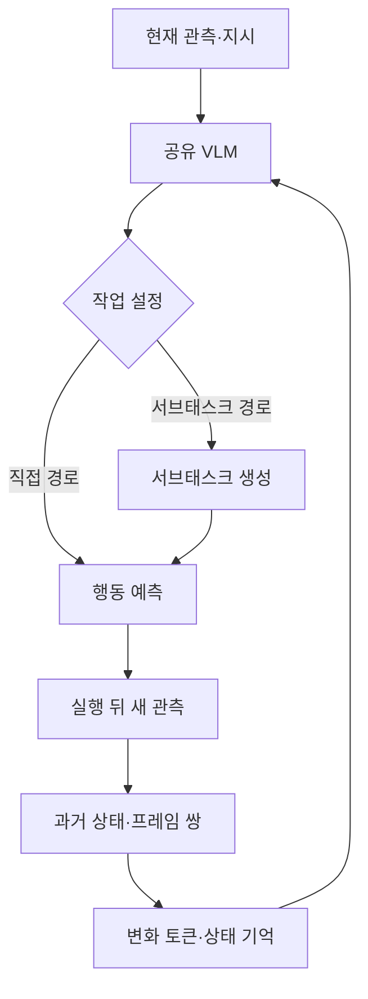

# AI · Robotics · Physical AI 주간 심층 보고서
## 2026년 10월 10일 21:00 KST 기준

**대상 기간:** 2026-10-03 21:00 이후부터 2026-10-10 21:00까지, Asia/Seoul  
**실제 작성일:** 2026-10-13 · 기준일을 소급 적용한 수동 발행

> 기간 내 발표 자료를 현재 재조회해 작성했습니다. 웹페이지의 당시 스냅샷을 모두 확보한 것은 아닙니다. 발표일을 확인한 사안만 포함하고 논문은 당시 공개된 v1을 고정합니다. 작성일에 확인한 코드 공개 상태는 별도 후속 점검으로 구분합니다.

## 핵심 요약

1. **로봇의 장기 작업 기억이 이번 주 연구의 중심이다.** EvoMem-VLA는 과거 이미지에 관측된 변화 정보를 결합한다. 반복 동작의 진행 상황을 기억하는 연구이며 범용 로봇 상용화가 입증된 것은 아니다. [논문 v1](https://arxiv.org/abs/2610.05418v1)
2. **에이전트의 역할이 시뮬레이션 도구 개발로 확장된다.** NVIDIA의 Omniverse 사례는 물리 시험과 장면 수정을 연결한다. 인간이 지도한 개발 사례와 실제 로봇 성공률은 구분해야 한다. [공식 발표](https://blogs.nvidia.com/blog/developers-simulation-frontier-ai-agents/)
3. **업무 에이전트 평가는 최종 산출물의 요구사항 충족으로 이동한다.** OpenAI·Ironclad의 루브릭 점수와 추정 시간을 고객의 실제 시간 절감으로 바꾸어 읽으면 안 된다. [공식 연구 발표](https://openai.com/index/advancing-computer-use-with-ironclad/)
4. **비용·지연·실행 위치를 함께 설계해야 한다.** Haiku 5.5, Windows의 로컬 추론·격리, EmbeddingGemma 2는 각각 모델, 실행 환경, 검색 표현의 변화다. 다른 평가 수치를 하나의 순위로 합치지 않는다.

## 목차

- [주요 동향 6건](#주요-동향-6건)
- [주간 Deep Dive: EvoMem-VLA](#주간-deep-dive-evomem-vla)
- [Physical AI 연구·상용화 관점](#physical-ai-연구상용화-관점)
- [기업별 추적 결과와 제외 기준](#기업별-추적-결과와-제외-기준)
- [자료와 검증 범위](#자료와-검증-범위)

## 주요 동향 6건

### 1. EvoMem-VLA: 현재 모습이 같아도 과거 행동은 다르다

**발표:** arXiv v1 제출 2026-10-04 17:59:43 UTC, 즉 10월 5일 02:59:43 KST.  
**1차 자료:** [초록·제출 이력](https://arxiv.org/abs/2610.05418v1) · [본문 v1](https://arxiv.org/html/2610.05418v1)

현재 관측 중심 VLA는 화면에서 사라진 작업 증거를 잃을 수 있다. EvoMem-VLA는 관측된 상태 변화의 표현을 기억에 넣어 이 문제를 다룬다. 논문 저자는 RMBench 80.7%, RoboMME 82.0%, 두 로봇의 네 실물 작업 평균 83.8%를 보고한다. 조건과 비교법은 Deep Dive에 제시한다.

**기술적 의미·해석:** 더 큰 모델을 쓰기 전에 정책 입력에 필요한 정보가 존재하는지 확인하는 접근이다. 현재 이미지가 진행 횟수를 구분하지 못한다면, 모델 규모만 키워도 입력의 모호성이 남는다. 장기 조립·정리·복구 작업에서 유익한 연구 관점이다.

**검증 수준:** 저자 실험을 담은 프리프린트다. 독립 재현이나 현장 장기 운영을 확인한 것으로 쓰지 않는다. 메모리 벤치마크의 개선을 모든 조작 작업으로 일반화하지 않는다.

### 2. NVIDIA Omniverse: 에이전트를 물리 시뮬레이션 개발에 투입

**발표:** 2026-10-08, 공식 페이지에 시각·시간대 미표기.  
**1차 자료:** [NVIDIA 개발 사례](https://blogs.nvidia.com/blog/developers-simulation-frontier-ai-agents/)

NVIDIA는 GPT-6 Astra 등을 이용해 자산 준비, 물리·센서 연결, 시험, 장면 수정을 수행한 사례를 소개했다. OpenUSD, Newton, Warp, Isaac Sim 등을 연결한다. Unitree G1의 한 허들 실험은 **시뮬레이션 100회 중 64회 성공**으로 보고됐다. 다른 사례는 실제·가상 카메라와 LiDAR 차이를 측정해 디지털 트윈을 개선했다.

**기존 접근과 차이:** 개발자가 모든 연결 코드를 직접 작성하는 대신 에이전트가 도구를 조합하고 시험 결과를 반영한다. 다만 인간의 지시·수정·수용 판단이 반복된다. 완전 자율 연구자로 표현할 근거는 없다.

**한계:** 64%는 단일 가상 실험의 값이다. 실물 G1의 안전성·전이를 의미하지 않는다. 사례 전반의 생산성을 공통 프로토콜로 비교한 표는 없다.

**산업적 의미·해석:** 실험을 구성하고 실패 원인을 찾는 비용이 줄어들 가능성이 있다. 후속 검증 변수는 개발 시간, 물리 오류, 조건 변화의 재현성, 실제 센서와의 잔여 오차다.

### 3. OpenAI·Ironclad: 클릭 성공 대신 업무 요구사항 충족을 평가

**발표:** 2026-10-06, 공식 페이지에 시각·시간대 미표기.  
**1차 자료:** [OpenAI 연구 발표](https://openai.com/index/advancing-computer-use-with-ironclad/)

계약·승인·조달 업무 **11개**를 선정하고 작업당 **8–50개 기준**으로 평가했다. 공개 계약 자료로 합성 훈련 작업을 구성하고 강화학습을 적용했다.

| 지표 | GPT-5.6 Sol | GPT-6 Astra | 조건 |
|---|---:|---:|---|
| 평균 루브릭 점수 | 41.6% | 55.0% | Sol High, Astra Max reasoning |
| 시도당 추정 시간 | 37.0분 | 19.2분 | 처리·생성 속도 가정의 시뮬레이션 추정 |

**해석:** 점수 차이는 **13.4%p**다. 완전한 작업 성공률과 같지 않으며 reasoning 설정도 다르다. 시간을 고객 현장에서 직접 측정한 절감률로 인용하면 안 된다.

**기술적 의미:** 다단계 에이전트에는 최종 업무 규칙을 시험할 환경과 피드백이 필요하다. 승인 금액 경계를 넘는 요청과 넘지 않는 요청이 각각 올바르게 처리되는지 확인해야 한다.

**검증 수준·한계:** 공급자·파트너 연구 평가이며 모든 Ironclad 업무를 대표하지 않는다. 산업적 가능성은 전문 소프트웨어의 규칙을 훈련·평가 자산으로 만드는 데 있다. 후속 과제는 미관측 규칙, UI 변경, 예외 처리와 반복 실행 비용이다.

### 4. Claude Haiku 5.5: 좁고 반복적인 작업의 비용 효율 개선

**발표:** 2026-10-07.  
**1차 자료:** [Anthropic 발표·가격·평가](https://www.anthropic.com/claude-haiku-5-5)

요약·분류·서브에이전트 등 고빈도 작업을 겨냥한 Haiku 5.5를 발표했다. effort 설정을 제공한다. 다음은 **Anthropic 게시값**이며 독립 재실행 결과가 아니다.

| 지표 | Haiku 4.5 | Haiku 5.5 | 조건 |
|---|---:|---:|---|
| OSWorld 2.1 | 15.7% | 72.4% | offline subset |
| Terminal-Bench 4.0 | 0.0% | 39.2% | 공식 발표표; 세부 설정은 system card 필요 |

| Haiku 5.5 API 가격 | 프롬프트 100k 토큰 이하 | 100k 초과 |
|---|---:|---:|
| 입력 100만 토큰 | $0.10 | $0.50 |
| 출력 100만 토큰 | $0.50 | $2.50 |

**한계:** system card 본문은 이번 조회에서 확보하지 못했다. 평가 설정을 완전히 감사했다고 주장하지 않는다. 작업당 비용에는 재시도·추론 길이·캐시·토크나이저도 영향을 준다.

**산업적 의미·해석:** 큰 모델의 계획과 작은 모델의 제한된 실행을 조합할 이유가 생겼다. 실효성은 성공한 작업당 총비용과 오류 검출·복구 비용으로 평가해야 한다. 컴퓨터 사용 점수를 로봇 실시간 제어 성능으로 바꾸어 해석하지 않는다.

### 5. Microsoft·NVIDIA: 로컬 모델과 OS 실행 경계를 함께 제공

**발표:** 2026-10-07.  
**1차 자료:** [NVIDIA](https://blogs.nvidia.com/blog/local-ai-rtx-spark-microsoft-windows-event/) · [Microsoft 로컬 모델·실행](https://commandline.microsoft.com/local-models-sandboxed-tools-github-windows/) · [Windows ML](https://devblogs.microsoft.com/foundry-on-windows/build-on-winml-oct-7-26/)

NVIDIA는 MXC 정식 제공과 RTX Spark 노트북 예약 판매를 소개한다. 출하는 **10월 16일 예정**으로 기준일에는 예약 판매 단계다. 상한 사양인 **128GB 통합 메모리·1 PFLOP FP4**는 실제 모델 처리량이나 모든 기기의 사양을 뜻하지 않는다.

Microsoft는 Windows ML의 실험적 llama.cpp·GGUF 지원과 preview Runtime API를 설명했다. GitHub Copilot의 로컬·클라우드 자동 조율은 **10월 말 예정**으로 구분했다.

**핵심 원리:** 추론 실행 위치와 도구 접근 경계를 별도로 설계한다. 양자화는 메모리를 줄이고 speculative decoding은 후보 토큰을 제안·검증한다. 모델이 메모리에 들어가도 KV cache·OS·앱 사용량 때문에 긴 작업의 지연이 달라진다.

**검증 수준·한계:** 공급자의 설명이며 하드웨어를 직접 시험하지 않았다. FP4 상한을 초당 토큰으로 환산하지 않는다. 격리 기능 출시를 모든 공격의 방어 증거로 쓰지 않는다.

**산업적 의미·해석:** 데이터 위치·지연·권한을 실행 환경에서 관리하는 방향이다. Physical AI에는 이와 별개로 센서 동기화, 제어 주기와 독립 정지 경로가 필요하다.

### 6. EmbeddingGemma 2: 텍스트·영상·음성을 공통 검색 공간에 연결

**발표:** 2026-10-06.  
**1차 자료:** [Google DeepMind 개발자 발표](https://blog.google/innovation-and-ai/technology/developers-tools/embeddinggemma-2/)

Google은 **740M 파라미터** 멀티모달 임베딩 모델을 공개했다고 발표했다. 텍스트 전용 270M에 선택적 시각·음성 인코더를 연결하며 벡터는 **768에서 128차원**까지 줄일 수 있다. Apache 2.0 라이선스로 소개했다.

**기존 접근과 차이:** 여러 모달리티를 공통 임베딩 공간에서 다룬다. MRL은 짧은 벡터도 활용하도록 표현을 구성한다.

**정량 해석:** 768/128=6은 벡터 원소 수의 비율이다. 인덱스·메타데이터를 포함한 전체 DB가 정확히 6배 작아지거나 검색 정확도가 유지된다는 뜻은 아니다. 미확인 benchmark 점수는 추가하지 않는다.

**연구적 연결·추론:** 로봇 영상·음성 지시에서 관련 에피소드를 검색할 후보 표현으로 시험할 수 있다. 검색 관련성과 행동 실행 가능성은 다르다. 촬영 조건·진행 단계가 유사한 실패 사례의 검색에서도 유효한지 검증해야 한다.

## 주간 Deep Dive: EvoMem-VLA

### 문제를 먼저 예시로 이해하기

**설명용 예시:** 컵을 세 번 들었다 내려놓는 로봇을 생각하자. 컵은 매번 같은 위치로 돌아온다. 1회 뒤와 3회 뒤 이미지가 같아도 다음 행동은 각각 “계속하기”와 “끝내기”로 다르다. 현재 장면만으로 진행 횟수를 복원할 수 없다.

행동 정책은 현재 관측뿐 아니라 필요한 이력의 표현에 의존해야 한다.

$$
a_t = \pi(o_t,\ell,m_t)
$$

$o_t$는 관측, $\ell$은 지시, $m_t$는 기억이다. 본 보고서의 설명용 식이며 원논문 식의 전사가 아니다. 모든 과거 영상을 쌓기보다 다음 행동을 바꾸는 정보를 보존해야 한다.

### 구조와 학습: 원논문의 핵심 압축

[논문 v1 §3·부록 A](https://arxiv.org/html/2610.05418v1)의 핵심이다.

- **변화 토큰:** 동결 DINOv3 특징의 순서 있는 프레임 쌍을 압축하고, 원본 특징 조건으로 목표 특징을 복원하는 log-cosh 손실을 쓴다. 단순 픽셀 차이·광류·행동 코드와 구분된다.
- **기억:** 시작·최근 상태와 변화 토큰을 결합한다. RMBench는 keyframe memory를 쓰지 않고 RoboMME는 최대 16개를 보관한다.
- **정책:** QwenOFT 기반, 시뮬레이션은 Qwen3-VL-4B-Instruct 초기화다. 경로는 학습 난도 판별기가 아니라 작업 설정이다. 직접 행동 예측 또는 생성 서브태스크에 조건부인 행동 예측이다.
- **손실:** 정책은 행동 L1, 서브태스크 token cross-entropy, keyframe BCE를 조합한다. tokenizer는 동결한다. 훈련은 정답 텍스트, 배포는 생성 텍스트를 사용한다.
- **데이터·예산:** 시뮬레이션 시연 쌍으로 tokenizer를 적응시키고 정책은 8 GPU·80,000 step이다. tokenizer 학습은 이 예산 밖이다. 실물은 합계 400개 시연, embodiment별 별도 정책이다.



도식은 정보 흐름의 요약이다. 서브태스크 텍스트를 같은 backbone의 다음 추론에 추가한다. 관측 변화 압축을 미래 상태를 생성하는 world model과 동일시하면 안 된다.

### 성능과 평가 조건

**저자 보고값**이다. [프로젝트 요약](https://yuhengna.github.io/EvoMem-VLA/)과 [논문 평가 절](https://arxiv.org/html/2610.05418v1)을 확인했다.

| 평가 | EvoMem-VLA | 비교법 | 개선 | 조건 |
|---|---:|---:|---:|---|
| RMBench | 80.7% | EventVLA VA-only 67.8% | +12.9%p | 9 작업, 작업당 100 episode, 공동 정책 1개 |
| RoboMME | 82.0% | FrameSamp Modul 44.5% | +37.5%p | 16 작업, 작업당 100 episode, 공동 정책 1개 |
| 실물 | 83.8% | πMEM 30.0% | +53.8%p | 4 작업 × 2 embodiment × 10 episode |

Franka와 AgileX COBOT에 **별도 정책**을 훈련했다. 한 정책의 두 로봇 zero-shot 전이 결과가 아니다. 실물은 작업별 성공률 평균이며 시뮬레이션과 합산하지 않는다.

[저자 ablation](https://yuhengna.github.io/EvoMem-VLA/)의 RMBench 값은 완전 모델 80.7%, 변화 토큰 제거 52.3%, 서브태스크 경로 제거 61.3%, 단순 특징 차이 대체 47.1%다. 통제 실험은 변화 표현의 유익성을 지지하지만 다른 모델의 규모·사전학습 차이를 모두 제거한 보편적 인과 증명은 아니다. 영상은 선택된 성공 사례라 영상으로 성공률을 추정하지 않는다.

### 재현성: 방법 공개와 실행 가능한 배포를 구분

방법·설정을 읽을 수 있다는 것과 동일 checkpoint의 동일 결과를 재현한다는 것은 다르다.

**작성일 후속 점검 — 기준일 이후 정보:** 2026-10-13에 조회한 [공식 코드 저장소](https://github.com/YuhengNa/EvoMem-VLA-Code)는 구현·checkpoint·설치·훈련·평가 진입점이 추후 공개 예정이라고 표시한다. 현재 재현성 감사에만 사용하며 10월 10일 상태가 같았다고 단정하지 않는다. 본 보고서에서 정책 학습·실물 시험이나 독립 재현을 수행하지 않았다.

### 실제 로봇에서 다음으로 시험할 질문

다음은 **보고서의 연구 질문**이며 논문이 입증했다고 주장하는 내용이 아니다.

1. **카메라 이동과 물체 변화를 구분하는가?** wrist camera 움직임의 배경 변화가 잘못된 진행 신호가 되는지 검사한다.
2. **시도와 성공을 구분하는가?** 컵을 들려 했지만 놓친 상황에서 명령 횟수 대신 실제 완료 횟수를 기억하는지 본다.
3. **기억이 틀렸을 때 복구하는가?** 누락·중복 이벤트 뒤 관측으로 기억을 교정할 수 있는지 평가한다.
4. **서브태스크 오류가 누적되는가?** “완료했다”는 문장을 물리적 완료의 증거로 사용했을 때 오류가 커지는지 시험한다.
5. **같은 계산 예산에서도 유익한가?** 추론 지연·메모리 사용을 고정한 비교, 여러 seed, 긴 작업·외부 환경 평가가 필요하다.
6. **안전한 정지와 독립적인가?** 작업 기억이 맞아도 충돌·과전류·관절 제한 검사는 별도로 필요하다.

### 작은 재현 실험: 정보 부족부터 확인하기

EvoMem-VLA 재현이라고 부르지 않는 **교육용 실험 제안**이다. 2D 환경에서 물체를 들었다 내려놓고, 같은 최종 이미지에 다른 완료 횟수 라벨을 준다.

| 입력 설정 | 비교 목적 |
|---|---|
| 현재 이미지 | 현재 장면의 모호성 |
| 최근 두 이미지 | 짧은 이력이 진행을 구분하는가 |
| 단순 특징 차이 누적 | 변화 표현의 작은 기준선 |
| 상태·학습된 변화 토큰 | 원논문 방향의 후속 실험 |

**수집할 값:** 횟수 정확도, 올바른 종료 비율, 누락 뒤 복구율, 단계당 지연. 잘못된 종료와 무한 반복도 따로 기록한다. episode 단위로 train/test를 나누고 같은 episode의 프레임을 양쪽에 섞지 않는다.

설명용 기준선은 다음과 같다. 신뢰할 수 있는 이벤트 입력을 가정하므로 실제 비전 인식의 난도는 해결하지 않는다.

```python
completed = 0
target = 3
for event in ["lift_succeeded", "returned", "lift_failed",
              "lift_succeeded", "returned", "lift_succeeded"]:
    if event == "lift_succeeded":
        completed += 1
    next_action = "stop" if completed >= target else "continue"
```

성공·실패 이벤트를 이미지에서 추론하도록 바꾸면 기억 구조와 지각 오류를 분리해 연구할 수 있다. 부분 관측, 시계열 표현, 모방학습, supervised loss, 데이터 누출을 함께 공부하는 과제로 적합하다. 이는 실험 제안이며 측정된 재현 결과가 아니다.

## Physical AI 연구·상용화 관점

**종합 해석:** 이번 주 자료는 기억, 실험 구성, 업무 평가, 실행 비용이라는 다른 병목을 보여준다. 아래는 제안한 검증 기준이며 상용 성과 표가 아니다.

| 분야 | 필요한 증거 | 잘못된 일반화 |
|---|---|---|
| 휴머노이드·매니퓰레이션 | 실물의 실패·복구·장기 반복 | 가상 허들 성공을 실물 범용성으로 해석 |
| VLA·모방학습 | 학습 이력, 미관측 작업, embodiment 분리 | 기억 작업 개선을 모든 조작에 확대 |
| world model | 미래 예측의 제어 유용성·접촉 정확도 | 관측 변화 압축을 미래 물리 생성과 동일시 |
| 강화학습 | 보상·최종 산출물·평가 분리 | 루브릭 점수를 완전 성공률로 표기 |
| sim-to-real | 센서·마찰·접촉·지연과 실물 시험 | 그럴듯한 렌더링을 정확한 물리로 가정 |
| 데이터·일반화 | 실패 시연, 시간 동기화, episode 분리 | 데이터 증가가 외부 전이를 보장한다고 가정 |
| 상용화 | 개입 빈도, 가동률, 실패 비용, 유지보수 | 예약 판매를 검증된 운영 실적으로 표기 |

모델 규모나 데이터 양보다 실패를 구분하고 다시 시험할 개발 체계도 살펴야 한다. 장기 작업에서는 마지막 이미지뿐 아니라 실제 완료와 예외 처리 기록이 평가 대상이어야 한다.

## 기업별 추적 결과와 제외 기준

| 추적 대상 | 이번 호 처리 |
|---|---|
| OpenAI | 10/6 Ironclad 평가 포함 |
| Anthropic | 10/7 Haiku 5.5 포함. 보안 프로그램·정책 발표는 핵심 6건 밖으로 확대하지 않음 |
| Google DeepMind | 10/6 EmbeddingGemma 2 포함. 공식 목록의 7월 Gemini Robotics 2는 신규로 재소개하지 않음 |
| NVIDIA | 10/8 Omniverse, 10/7 Microsoft 공동 발표 포함 |
| Microsoft | 로컬 추론·MXC·Copilot의 제공·예정·preview 상태 구분 |
| Meta | 조회한 공식 목록에서 기간 내 해당 주제의 중대한 신규 발표를 확인하지 못함. “발표가 없었다”는 전수 조사 결론은 아님 |

목록: [Google DeepMind](https://deepmind.google/blog/) · [Meta AI](https://ai.meta.com/results/).

**제외:** 10월 12일 NVIDIA OCP 발표는 기준일 이후다. 9월 이전 로봇 모델·Isaac ROS 자료를 주간 신규 성과로 포장하지 않았다. 대상 폴더에서 기존 브리핑 본문을 확보하지 못했으므로 이전 호와의 완전한 중복 대조는 보장하지 않는다.

## 자료와 검증 범위

발표는 공식 페이지, 수치는 원논문·공급자 표에서 확인했다. 다른 benchmark·reasoning·하드웨어·subset을 합쳐 순위를 만들지 않았다. 독립 재현은 수행하지 않았으며 미확인 구조·훈련 데이터·세부값을 추정하지 않았다. 기준일 이전 발표와 작성일 후속 감사의 경계를 유지한다. 이 문서는 예약 자동 실행 결과가 아닌 수동 소급 발행이다.

### 주요 원문

1. [EvoMem-VLA v1 · 10/4 UTC 제출](https://arxiv.org/abs/2610.05418v1)
2. [EvoMem-VLA 본문·부록 v1](https://arxiv.org/html/2610.05418v1)
3. [EvoMem-VLA 결과·영상](https://yuhengna.github.io/EvoMem-VLA/)
4. [코드 공개 상태 · 작성일 감사](https://github.com/YuhengNa/EvoMem-VLA-Code)
5. [NVIDIA Omniverse · 10/8](https://blogs.nvidia.com/blog/developers-simulation-frontier-ai-agents/)
6. [OpenAI Ironclad · 10/6](https://openai.com/index/advancing-computer-use-with-ironclad/)
7. [Anthropic Haiku 5.5 · 10/7](https://www.anthropic.com/claude-haiku-5-5)
8. [NVIDIA RTX Spark·Microsoft · 10/7](https://blogs.nvidia.com/blog/local-ai-rtx-spark-microsoft-windows-event/)
9. [Microsoft Windows ML · 10/7](https://devblogs.microsoft.com/foundry-on-windows/build-on-winml-oct-7-26/)
10. [Microsoft 로컬 모델·sandboxed tools · 10/7](https://commandline.microsoft.com/local-models-sandboxed-tools-github-windows/)
11. [Google EmbeddingGemma 2 · 10/6](https://blog.google/innovation-and-ai/technology/developers-tools/embeddinggemma-2/)
