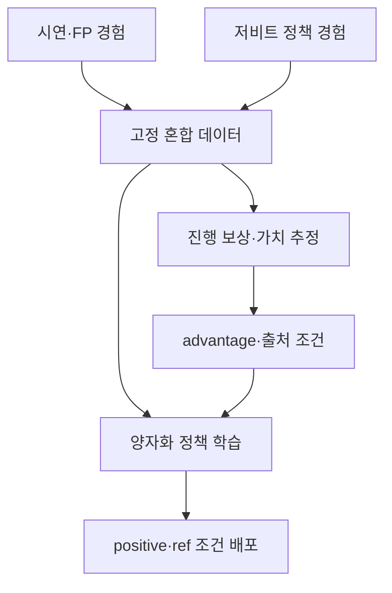

# AI · Robotics · Physical AI 주간 심층 보고서
## 2026-10-17 — 효율적인 로봇은 작업을 끝낼 수 있어야 한다

**자료 기준:** 2026-10-17 21:00 KST  
**조사 기간:** 2026-10-10 21:00 이후부터 2026-10-17 21:00까지  
**읽는 법:** 논문 수치는 저자 실험, 기업 데모는 기업 보고로 표시했다. 독립 재현을 수행하지 않았으며, 해석과 후속 실험 제안은 본 보고서의 분석이다.

## 핵심 요약

1. **온디바이스 VLA의 다음 과제는 압축 후 작업 완수다.** QCRL은 양자화 정책의 실패·부분 완료와 고정밀 정책의 경험을 오프라인 강화학습에 활용한다. FP 대비 99.3%라는 수치는 평균 점수의 보존 비율이다. 절대 작업 성공률로 읽지 않는다. [논문](https://arxiv.org/abs/2610.15675v1)
2. **생성의 출발점을 바꾸면 로봇 추론 비용도 달라진다.** Δ-flow는 최근 행동·상태 주변에서 미래를 생성한다. 가우시안 출발의 다단계 샘플링을 줄이지만, 모든 조건에서 성능이 함께 오르지는 않는다. [논문](https://arxiv.org/abs/2610.15794v1)
3. **물리 지식을 훈련 과정에 넣는 접근이 확장된다.** FlowVLA는 훈련 전용 3D 움직임 감독으로 기존 RGB 정책을 보강한다. Google Argon 사례는 물리 추론·시뮬레이터·행동 도구를 연결한다. [FlowVLA](https://arxiv.org/abs/2610.16160v1) · [Google](https://developers.googleblog.com/gemini-4-argon-for-robotics/)
4. **산업용 데이터는 감각과 시간의 정렬이 중요해진다.** NEURA는 촉각·음향·기억을 포함하는 PLA 모델을 발표했다. 센서가 늘어날수록 동기화·고장 대응·보정 비용도 검증해야 한다. [NEURA](https://neura-robotics.com/neuron-ai/)
5. **디지털 에이전트의 병목도 주변 시스템으로 이동한다.** Anthropic의 Scion은 소스 제어의 확장 문제를, Meta의 AutoformBench는 중간 정의·보조정리 구성 능력을 드러낸다. 생성량, 검증 가능성, 실제 유용성을 함께 평가해야 한다.

## 목차

- [이번 주 주요 동향 7건](#이번-주-주요-동향-7건)
- [Deep Dive — QCRL](#deep-dive--qcrl)
- [연구 준비를 위한 작은 실험](#연구-준비를-위한-작은-실험)
- [산업과 후속 연구에 주는 의미](#산업과-후속-연구에-주는-의미)
- [기업별 추적과 지난 호 대비 변화](#기업별-추적과-지난-호-대비-변화)
- [출처·검증 기록](#출처검증-기록)

## 이번 주 주요 동향 7건

### 1. QCRL: 4비트 정책이 실제 작업을 마치도록 경험으로 보정

**공개:** arXiv v1, 2026-10-11 14:56:31 UTC → 10월 11일 23:56:31 KST.  
**원문:** [초록·이력](https://arxiv.org/abs/2610.15675v1) · [본문·실험](https://arxiv.org/html/2610.15675v1)

연구진은 5개 VLA의 실물 시험 4,050회에서 PTQ와 QAT의 한계를 조사했다. QCRL은 시연, 고정밀 정책의 rollout, 양자화 정책의 rollout을 함께 이용한다. 부분 완료를 평가하고 경험의 출처를 조건으로 넣어 저비트 정책을 개선한다.

**정량 핵심:** π0.5의 INT4 W4A16은 세 시각 변화 조건의 평균 점수를 FP의 99.3%까지 보존했다고 보고했다. NVFP4 W4A4의 대응 비율은 100.7%다. 수치의 분모·작업 조건·하드웨어 비교는 Deep Dive에서 분리한다.

**기술적 의미·해석:** 압축 모델의 출력 오차가 작아도 접촉이 달라지면 다음 관측과 작업 경로가 바뀐다. 배포 정책이 방문하는 실패 상태를 학습에 포함하는 접근이 중요하다.

**검증:** 프리프린트의 저자 실험이다. 산업 전반의 안전성이나 모든 로봇에서의 성능 보장을 뜻하지 않는다.

### 2. Δ-flow: 과거 이력에서 미래로 이동하는 생성 정책

**공개:** arXiv v1, 2026-10-11 17:31:44 UTC → 10월 12일 02:31:44 KST.  
**원문:** [논문](https://arxiv.org/abs/2610.15794v1) · [프로젝트](https://zuo-kuangji.github.io/delta-flow/)

기존 flow matching의 가우시안 source를 최근 이력과 작은 잡음으로 바꿔 미래까지의 변화량을 학습한다. VLA π0.5와 미래 시각 상태도 생성하는 WAM인 ImageWAM·Fast-WAM에 적용했다.

| 모델 | 1-step 추론 가속 | 비교 기준 |
|---|---:|---|
| π0.5 | 1.54배 | 논문의 10-step 가우시안 설정 |
| ImageWAM | 2.49배 | 동일 모델 계열 비교 |
| Fast-WAM | 4.45배 | 동일 모델 계열 비교 |

수치는 저자 초록 기준이다. ImageWAM의 LIBERO-Plus는 82.49%에서 88.55%로 개선됐지만, 기본 LIBERO는 98.00%에서 97.80%였다. **강건성과 기본 성능 사이의 작은 차이도 함께 남겨야 한다.** [본문 표](https://arxiv.org/html/2610.15794v1)

**재현성:** 조회한 [공식 저장소](https://github.com/NTUMARS/delta-flow-matching)는 코드 미공개 상태다. README의 가속 범위가 논문과 달라 본문은 버전이 고정된 논문 수치를 우선했다.

**후속 질문·해석:** 급격한 접촉 변화, 실패 직후, 오래된 이력이 오히려 잘못된 prior가 되는 상황을 시험해야 한다. 학습 epoch 감소와 실제 GPU 시간 절감은 따로 측정할 항목이다.

### 3. FlowVLA: 3D 동역학을 훈련에서 배우고 배포 비용은 억제

**공개:** arXiv v1, 2026-10-12 04:34:14 UTC → 10월 12일 13:34:14 KST. 논문 페이지는 CoRL 2026 채택을 명시한다.  
**원문:** [논문](https://arxiv.org/abs/2610.16160v1) · [실험·영상](https://mmai-laboratory.github.io/flowvla/)

RGB 시퀀스의 3D 점 궤적을 복원하고 점의 미래 변위와 로봇 TCP 움직임을 함께 감독한다. 이 보조 head들은 추론에서 제거된다. 로봇 base 좌표와 복원 좌표의 정렬이 학습 신호의 핵심이다.

| 설정 | 기존 정책 | +FlowVLA | 조건 |
|---|---:|---:|---|
| Seer · LIBERO 전체 | 87.3% | 92.4% | 저자 시뮬레이션 평가 |
| π0.5 · LIBERO 전체 | 96.8% | 97.5% | 같은 논문 내부 비교 |
| Seer · LIBERO-Plus | 36.1% | 41.1% | 추가 fine-tuning 없는 변화 조건 |

실물은 UR5e의 7개 작업으로, 작업당 시연 40개와 정책별 평가 15회다. 훈련 시간 약 1.26배라는 비용은 남는다. [프로젝트](https://mmai-laboratory.github.io/flowvla/)

**의미·한계:** 훈련 중 풍부한 감독을 배포 정책에 전달하는 전략이다. 재구성·보정 오류와 움직이는 배경의 영향을 확인해야 한다. 위 π0.5 기준값은 Δ-flow 논문의 기준값과 다르므로 두 방법의 숫자로 직접 순위를 만들 수 없다.

### 4. Gemini 4 Argon의 로봇 사례: 추론·코드·물리 도구의 결합

**발표:** Google Developers Blog, 2026-10-13.  
**원문:** [Gemini 4 Argon for Robotics](https://developers.googleblog.com/gemini-4-argon-for-robotics/)

Google은 ERQA 물리·공간 추론에서 **87%**를 보고했다. 또한 Spot의 쓰레기통 페달 작업에서 MuJoCo 연습을 사용하고, 보정된 좌표·행동 primitive를 통해 로봇 팔을 조작한 사례를 소개했다. Real2Sim, 시연 후처리와 작업 진행 평가도 다룬다.

**기존 접근과 차이:** 모델 단독의 행동 출력보다 보정된 관측, 실행 가능한 skill, 물리 시험과 검증 절차가 결합된 작업 흐름이 두드러진다.

**검증 수준:** ERQA는 질의 응답 평가이며 로봇 작업 성공률과 다르다. 블로그 데모의 반복 시험 횟수·모든 실패·개입 빈도에 대한 통합 표를 확보하지 못했다. 회사의 “zero-shot” 표현은 제공된 harness·primitive·좌표 보정의 조건과 함께 읽어야 한다.

**산업적 의미·추론:** 데이터 라벨링·시뮬레이터 구성·실패 분석을 지원할 가능성이 있다. 실제 배포에서는 시뮬레이터 접촉 오차, 호출 지연, 행동 도구의 허용 범위를 포함한 평가가 필요하다. 이번 주의 변화는 로봇 활용 사례 공개이며 모델 자체의 최초 출시로 표현하지 않는다.

### 5. NEURA Neuron AI: 촉각·음향·기억을 묶는 PLA

**발표:** 2026-10-14.  
**원문:** [공식 발표](https://neura-robotics.com/de/neura-robotics-stellt-neuron-ai-vor-das-gehirn-der-physischen-welt/) · [제품 설명](https://neura-robotics.com/neuron-ai/)

NEURA는 3D 시각, 촉각·힘, 음향, 로봇 상태, 언어와 기억을 결합한다고 설명한다. 실로봇·시뮬레이션·사람 시연을 데이터 축으로 삼고, 다섯 form factor에 적용하며 로컬 실행한다고 밝혔다. 4NE1의 11분 연속 자율 시연도 회사가 보고했다.

**기술적 의미:** 잠금장치의 해제나 삽입 완료는 소리와 힘으로 관측할 여지가 있다. 기억은 물체가 가려진 뒤의 작업 맥락을 보존하는 데 필요하다.

**검증 공백:** 조회한 자료에서 모델 규모·손실함수·센서별 ablation·공통 benchmark·지연 수치를 확인하지 못했다. 동기화와 정렬의 구체 구현도 공개 설명을 넘어 추정하지 않는다. 11분 시연은 반복 운영 신뢰도를 대신할 수 없다.

**산업적 의미·해석:** 데이터 수집에서 센서 정렬·시간축·실패 라벨의 가치가 커진다. PLA라는 명칭만으로 다른 VLA가 촉각이나 기억을 사용할 수 없다고 일반화해서는 안 된다. 기업 간 비교에는 관측·작업·하드웨어를 맞춘 실험이 필요하다.

### 6. Anthropic Scion: 에이전트가 늘리면 소스 제어도 병목이 된다

**발표:** 2026-10-13, 10월 15일 설명 추가.  
**원문:** [Anthropic engineering](https://www.anthropic.com/engineering/redesigning-source-control)

Anthropic은 일일 merge가 5월 약 2,500건에서 9월 30,000건 이상으로 늘었다고 보고했다. 5개월에 걸쳐 자체 소스 제어 Scion으로 이전했다. 온라인 client를 전제로 서버의 이력·merge 처리, API, sparse·가상 checkout과 수평 확장에 집중한다.

**의미:** 코드 생성이 늘면 checkout·review·CI·rollback의 비용이 커진다. Scion의 변화 단위 처리와 필요한 데이터만 읽는 설계는 대량 실험·에이전트 sandbox에 참고할 만하다.

**검증 수준·한계:** 회사의 내부 운영 설명이다. merge 건수는 유용한 기능이나 연구 생산성의 배수가 아니다. 분산 offline 작업의 장점을 가진 Git을 모든 팀이 대체해야 한다는 결론도 나오지 않는다.

**후속 지표·해석:** 변경당 검증 시간, 결함·되돌리기 비율, 권한 경계, 서로 충돌하는 변경의 처리 비용을 함께 봐야 한다. 로봇 연구에서도 생성 코드의 양보다 실험 설정·모델·데이터 버전의 연결성이 중요하다.

### 7. Meta AutoformBench: 증명 앞의 정의와 보조정리까지 평가

**발표:** 2026-10-13.  
**원문:** [Meta 연구 소개](https://ai.meta.com/research/publications/autoformbench-a-lean-formalization-benchmark-for-advanced-mathematics/)

24개 고급 수학 자료에서 나온 **Lean 4 형식화 과제 341개**다. 비형식 증명을 제공하지만 빠진 정의·보조정리·연결 구조를 에이전트가 구성해야 한다. target statement는 Lean 경험이 있는 수학자가 형식화·감사했다고 설명한다.

**문제 정의:** 이미 준비된 라이브러리 위의 한 정리 증명과, 필요한 기반을 구축하는 연구 과정은 요구 능력이 다르다. 도구 사용·장기 의존성 관리·중간 산출물 검증을 함께 측정한다는 의미가 있다.

**검증 한계:** 공식 소개의 모델별 수치를 별도 재실행하지 않았다. Lean 통과 여부와 비형식 명제의 의도 일치도도 구분해야 한다.

**Physical AI와의 연결·추론:** 로봇 성능의 직접 증거는 아니다. 다만 계획을 검증 가능한 중간 조건으로 분해하는 평가 관점은 작업 계약·행동 전제조건 설계에 참고할 수 있다.

## Deep Dive — QCRL

### 왜 출력 오차보다 작업 결과가 중요한가

**설명용 예시:** 4개 물건을 정리하는 작업에서 3개를 끝내고 마지막에 실패한 rollout과, 첫 물건도 못 집은 rollout을 생각하자. 둘 다 최종 성공 라벨은 0이다. 그러나 학습에 필요한 정보는 다르다. 반대로 높은 부분 완료 점수만으로 마지막 정리까지 성공했다고 말할 수도 없다.

양자화는 연산·메모리를 줄이는 대신 표현 가능한 값에 반올림한다. 로봇에서는 작은 행동 차이가 접촉 실패를 만들고, 다음 관측을 바꾸며, 그다음 정책 입력까지 바꾼다. 따라서 기록된 이미지에서 행동 벡터를 잘 맞추는 평가와 실제 폐루프의 완료 평가는 함께 필요하다.

### 원논문의 방법·구조·학습

[QCRL 본문 §IV–V](https://arxiv.org/html/2610.15675v1)의 압축 요약이다.

- **데이터:** 시연·FP rollout·PTQ rollout을 고정 데이터로 섞는다. FP 모델은 reference 경험을 공급한다.
- **가치 추정:** 부분 완료율 $p$에 따라 종단 보상을 $-\lambda_f(1-p)$로 정하고 return을 학습한다. 매 subgoal마다 주는 dense reward와 구분된다.
- **정책 조건:** advantage의 positive/negative와 출처 ref/quant를 구분한다. 배포는 positive·ref 조건의 **양자화 정책**이다.
- **목표:** 조건부 행동 모델링 손실과 무조건부 보조 항을 함께 사용한다. 대상 π0.5·GR00T N1.5의 행동 손실은 flow matching이다.
- **예산:** 가치 모델 18k, 정책 30k update. 학습은 ID 데이터만 사용한다. FP·가치 모델·진행 라벨은 오프라인 학습에 사용한다.



**분석:** ref 조건은 데이터의 출처 선택이다. 추론할 때 FP 모델로 전환하는 장치로 이해하면 배포 메모리와 성능 해석이 틀어진다. 또 부분 완료 rollout 전체의 모든 행동이 좋은 행동으로 분류되는 것도 아니다.

### 숫자를 해석할 때 분모부터 확인하기

[초록](https://arxiv.org/abs/2610.15675v1)의 99.3%와 100.7%는 세 시각 변화 조건의 평균 점수/FP 기준 평균 점수다. 후자는 FP 기준보다 약간 높은 평균이라는 뜻이며 100%가 넘는 절대 성공률이 아니다.

**모델·정밀도·하드웨어의 세 축을 분리해야 한다.** INT4 W4A16과 NVFP4/FP8의 자원·속도 효과는 같은 값이 아니다. 비교 연구의 4,050회는 5개 모델의 FP/PTQ/QAT 조사를 가리키며 QCRL 단독의 시험 횟수로 표기하지 않는다.

### 실물 작업: 부분 완료와 완전 성공

[논문 Table VI](https://arxiv.org/html/2610.15675v1)는 Trossen ViperX 실물 평가다. 아래는 π0.5, 양자화법은 INT4 W4A16, 긴 작업은 설정당 **10회** 평가다. 모두 저자 측정치다.

| 작업·지표 | FP | PTQ | QAT | QCRL |
|---|---:|---:|---:|---:|
| Folding · 완전 성공 | 40.0% | 0.0% | 0.0% | 30.0% |
| Folding · 진행 점수 | 60.0% | 15.0% | 40.0% | 60.0% |
| Clean desk · 완전 성공 | 50.0% | 20.0% | 30.0% | 50.0% |

**분석:** Folding의 QAT는 중간 단계를 더 수행하면서도 완전 성공은 0이었다. QCRL은 완료를 회복했지만 이 설정의 FP 완전 성공까지 모두 회복한 것은 아니다. 긴 작업의 10회에서 1회 차이는 10%p이므로 작은 차이의 통계적 유의성을 단정하지 않는다.

### 배포: 메모리 절약과 지연 감소의 조건

[논문 Table VII–VIII](https://arxiv.org/html/2610.15675v1), π0.5·TensorRT·Jetson Thor의 저자 보고값이다.

| 실행 형식 | 모델 메모리 | peak 메모리 | 추론 지연 |
|---|---:|---:|---:|
| FP16 | 6.46 GiB | 8.02 GiB | 96.61 ± 2.37 ms |
| INT4 W4A16 | 3.69 GiB | 5.31 GiB | 이 표에 별도 지연값을 옮기지 않음 |
| NVFP4/FP8 배포 | 2.80 GiB | 2.81 GiB | 55.85 ± 0.10 ms |

NVFP4 runtime은 1,000 sample 측정이다. 속도 이득은 저정밀 runtime의 효과이며 PTQ·QAT·QCRL이 같은 정밀도에서 공유한다. QCRL의 역할은 그 실행 조건에서 작업 능력을 개선하는 것이다.

**분석:** 96.61/55.85≈1.73은 해당 추론 지연의 비율이다. 카메라·통신·전처리·액추에이터까지 포함한 로봇 주기가 자동으로 1.73배 빨라진다는 뜻은 아니다. 모델 메모리와 peak 메모리도 구분해야 한다.

### 한계와 재현성

방법과 표를 확인했지만 실행 가능한 공식 QCRL 코드·checkpoint는 이번 조사에서 확인하지 못했다. 기반 openpi·LeRobot 자료가 있다는 이유로 QCRL 재현이 가능하다고 주장하지 않는다. 본 보고서에서 VLA 재학습·실물 독립 재현은 수행하지 않았다.

**연구 질문:**

1. 실패 상태를 더 수집했을 때 초기 성공률·환경별 데이터 비중이 결과를 얼마나 바꾸는가?
2. 접촉·정렬에 민감한 작업에서도 ID-only 학습의 전이가 유지되는가?
3. 진행 라벨이 잘못되거나 과장될 때 가치 모델과 정책이 어떻게 실패하는가?
4. 동일 rollout·update 예산을 준 FP adaptation과 비교해 양자화 고유의 회복을 얼마나 분리할 수 있는가?
5. 온도·전력 제한·긴 영상 context·센서 장애에서도 지연과 완전 성공을 유지하는가?

논문도 일반 adaptation과 양자화 회복이 조건별로 함께 작용한다고 설명한다. 장기 반복·새 하드웨어·실패 복구의 외부 검증이 남아 있다.

## 연구 준비를 위한 작은 실험

### 직접 실행한 교육용 1차원 예시

이 절은 **본 보고서가 구성·실행한 장난감 실험**이다. QCRL 논문 수치나 VLA 재현 결과에 포함되지 않는다.

목표 위치 1, 시작 0, 행동 $u=0.3(1-x)$인 비례 제어기를 40회 실행한다. 두 번째 실행은 행동을 0.1 간격으로 반올림한다. 성공 조건은 최종 오차 0.02 미만이다.

```python
for quantized in [False, True]:
    x = 0.0
    for _ in range(40):
        u = 0.3 * (1.0 - x)
        if quantized:
            u = 0.1 * round(u / 0.1)
        x += u
    print(quantized, x, abs(1.0 - x) < 0.02)
```

| 실행 | 최종 위치 | 최종 오차 | 완전 성공 |
|---|---:|---:|---|
| 반올림 없음 | 0.999999363 | 0.000000637 | 참 |
| 0.1 간격 반올림 | 0.900000000 | 0.100000000 | 거짓 |

**어떤 일이 일어났나:** 목표 근처에서 명령이 작아지면 0으로 반올림되어 더 이상 움직이지 않는다. 각 행동의 반올림 오차가 작다는 사실만으로 원하는 종료 조건을 보장하지 못한다. 실제 신경망 weight 양자화·QAT·RL을 구현한 예시는 아니며 그 효과를 수치로 예측하지 않는다.

### 다음 단계로 확장할 실험 설계

- tolerance와 양자화 간격을 바꿔 최종 오차·완료율·단계를 기록한다.
- 동일 초기 상태와 외란 seed를 두 정책에 적용해 비교한다.
- 기록된 상태에서 행동 MSE와 rollout 최종 성공을 각각 측정한다.
- 이후 작은 모방학습 정책에 fake quantization을 넣고, 시연만 사용한 학습과 실패 경험을 추가한 학습을 비교한다.
- episode 단위로 train/test를 분리하고 새 초기 위치·외란을 test에 남긴다.

연구 준비의 핵심 개념은 **폐루프 제어, offline RL, advantage, 분포 변화, 양자화 형식, 부분 완료 지표, 실험 통제**다. 먼저 작은 시스템에서 원인을 분리한 뒤 VLA benchmark로 확장하면 결과를 설명하기 쉽다.

## 산업과 후속 연구에 주는 의미

다음은 여러 자료를 연결한 **분석·검증 제안**이다.

### 모델 효율의 단위가 작업으로 바뀐다

한 번의 추론이 싸져도 재시도가 늘면 물건 한 개를 정리하는 비용은 커질 수 있다. 모델 메모리·지연과 함께 완전 성공당 에너지, 실패 복구 시간, 사람 개입률을 기록해야 한다. QCRL은 압축 후의 결과를, Δ-flow는 생성 경로를, FlowVLA는 훈련 감독을 바꾸는 서로 다른 축이다. 세 방법의 결합 효과는 직접 검증할 연구 과제다.

### world model과 sim-to-real의 검증은 두 겹이다

예측 영상이 자연스러운지와 그 예측이 접촉·힘·다음 행동의 판단에 유익한지는 따로 평가한다. Argon·시뮬레이션 도구는 실험 구성을 돕지만, 재질·마찰·센서 지연을 틀리게 모델링하면 정책도 틀린 조건에서 학습할 수 있다. 실물 시험을 연결하고 실패 조건의 범위를 기록해야 한다.

### 데이터 공장은 시연 수보다 정렬된 경험을 남겨야 한다

Neuron AI처럼 촉각·음향을 결합할 때는 공통 시계, 센서 누락 표시, 보정 이력, 실제 성공 판정이 중요하다. 손이 움직였다는 영상과 물건을 제대로 집었다는 라벨은 다른 정보다. 작업 중 가림·미끄러짐·실패 복구를 포함해야 일반화의 한계를 확인할 수 있다.

### 검증할 중간 산출물이 더 중요해진다

Scion의 코드·CI 병목, AutoformBench의 누락 정의·lemma는 생성 모델 주변의 구조가 결과를 좌우함을 보여준다. 로봇 연구에서는 환경 버전·학습 데이터·checkpoint·runtime·평가 seed의 연결을 남겨야 한다. 생성된 실험 코드가 실제 조건을 구현했는지도 검사해야 한다.

## 기업별 추적과 지난 호 대비 변화

[지난 호](2026-10-10_AI-PhysicalAI_주간.md)를 읽어 이번 호와 대조했다.

| 대상 | 이번 주 처리·검증 범위 |
|---|---|
| OpenAI | [10/15 Rosalind Academic Plan](https://openai.com/index/introducing-the-rosalind-academic-plan/) 확인. 연구 접근 지원 확대이며 새 로봇 모델 성능 발표로 선정하지 않음 |
| Anthropic | Scion engineering을 선정. 지난 호 Haiku 5.5 출시·가격표는 반복하지 않음 |
| Google DeepMind | Argon의 10/13 로봇 활용 사례를 선정. 기존 모델의 최초 출시와 구분 |
| NVIDIA | QCRL의 GR00T N1.5·Jetson Thor 실험을 다룸. [10/12 OCP 자료](https://blogs.nvidia.com/blog/ocp-global-summit-vera-rubin-scale-ai-factories/)는 인프라 발표로 확인하고 새 로봇 성능으로 확대하지 않음 |
| Microsoft | [연구 목록](https://www.microsoft.com/en-us/research/blog/)의 10/12 StudentSim·10/15 Magnetar 확인. 이번 Physical AI 중심 핵심 7건에는 포함하지 않음 |
| Meta | AutoformBench의 10/13 공개 확인. 로봇 성능과 직접 혼동하지 않음 |

지난 호 EvoMem-VLA·Ironclad·EmbeddingGemma 2·10/7 Windows 발표는 실질적인 새 성과를 확인하지 못한 항목으로 재설명하지 않았다. “기간 내 선정하지 않음”은 해당 기업의 모든 발표가 없었다는 뜻이 아니다.

## 출처·검증 기록

**정보 기준:** 발표일·arXiv v1 제출 이력을 우선했다. 블로그의 게시일만 제공되면 정확한 발표 시각은 추정하지 않았다. 표의 수치는 원문 내부 설정에만 적용한다. 논문·기업 주장의 독립 검증을 수행하지 않았다. 연구 질문·장난감 실험·종합 해석은 구분해 표시했다.

1. [QCRL · arXiv v1](https://arxiv.org/abs/2610.15675v1) — 10/11 UTC 제출
2. [QCRL · 방법·Table VI–VIII·부록](https://arxiv.org/html/2610.15675v1)
3. [Δ-flow · arXiv v1](https://arxiv.org/abs/2610.15794v1) — 10/11 UTC 제출
4. [Δ-flow · 본문](https://arxiv.org/html/2610.15794v1)
5. [Δ-flow · 저자 프로젝트](https://zuo-kuangji.github.io/delta-flow/)
6. [Δ-flow · 코드 공개 상태](https://github.com/NTUMARS/delta-flow-matching)
7. [FlowVLA · arXiv v1](https://arxiv.org/abs/2610.16160v1) — 10/12
8. [FlowVLA · 방법과 실험](https://arxiv.org/html/2610.16160v1)
9. [FlowVLA · 저자 프로젝트](https://mmai-laboratory.github.io/flowvla/)
10. [Google Argon robotics](https://developers.googleblog.com/gemini-4-argon-for-robotics/) — 10/13
11. [NEURA · Neuron AI 발표](https://neura-robotics.com/de/neura-robotics-stellt-neuron-ai-vor-das-gehirn-der-physischen-welt/) — 10/14
12. [NEURA · 제품·센서·데이터 설명](https://neura-robotics.com/neuron-ai/)
13. [Anthropic · Scion](https://www.anthropic.com/engineering/redesigning-source-control) — 10/13, 10/15 갱신
14. [Meta · AutoformBench](https://ai.meta.com/research/publications/autoformbench-a-lean-formalization-benchmark-for-advanced-mathematics/) — 10/13
