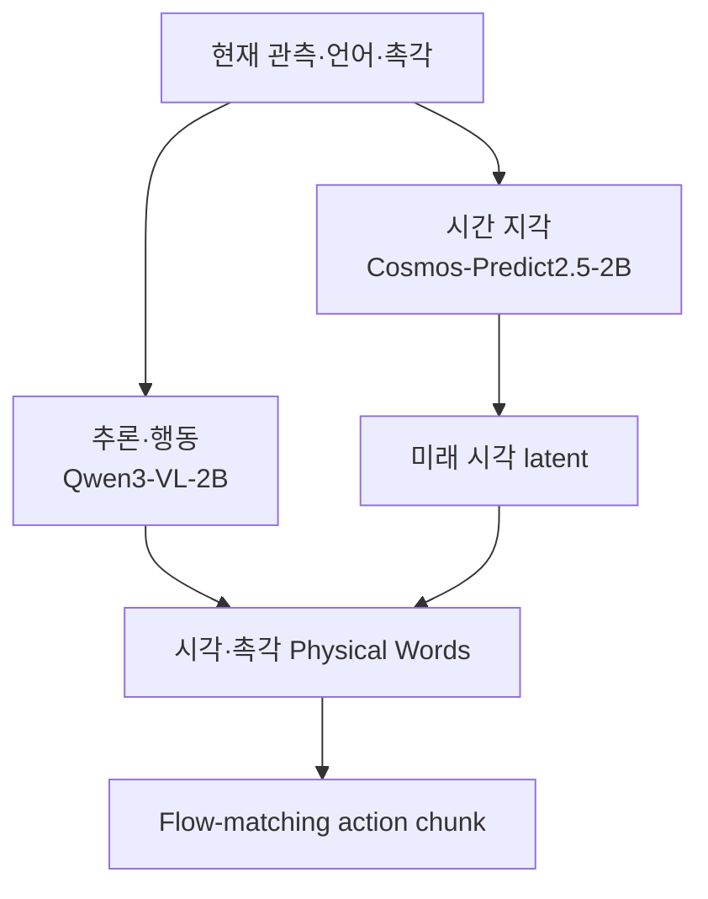

# AI · Robotics · Physical AI 주간 심층 보고서

**2026-10-24 — 로봇의 ‘생각’이 언어·미래 감각·장면 문맥으로 구조화되기 시작했다**

- **PhysWord**는 16개 원자 행동어를 미래 시각·촉각 잠재표현에 직접 정렬해 UniVTAC 90.3%, LIBERO-Long 99.6%, 실제 로봇 4개 과제 평균 71.7% 성공률을 보고했다.
- **COWBOY**는 전신 제어기와 국소 RL 전문가를 결합·증류해 24개 실제 장면에서 평균 91% grasp 성공률을 보였다. 독립 재현은 아직 없다.
- **OpenTac**은 형상별 촉각 스킨 설계·시뮬레이션·센서 간 전이·최대 1,286 Hz 적응 샘플링을 하나의 개방형 stack으로 묶었다.
- **OpenAI 분산 과학 agent**는 수백만 뇌세포 데이터 분석을 32분에 수행했다. 문헌 탐색 폭은 늘었지만 생물학적 가설은 후속 실험이 필요하다.
- **프런티어 agent 보안**은 학습 infrastructure 격리가 연구 경쟁력의 일부가 되었음을 보여준다.

> 조사 범위: 2026-10-17 21:00–2026-10-24 21:00 KST. 지난 호의 QCRL, Delta-flow, FlowVLA, Gemini 4 Argon Robotics, NEURA Neuron AI, Anthropic Scion, AutoformBench는 실질적 새 근거가 확인되지 않아 반복하지 않았다.

## 검증 기준

발표 시점이 조사 범위에 들어오고 원문·논문·평가 조건을 직접 확인할 수 있으며 기술 변화가 분명한 사안만 골랐다. 수치는 같은 표·같은 protocol 안에서만 비교했다. 논문 결과는 저자 보고, 기업 blog는 기업 주장으로 구분했고 별도 연구팀 재현이 없으면 독립 검증으로 보지 않았다.

## 1. PhysWord: 행동어를 미래 물리 상태의 좌표계로 사용

**발표:** 2026-10-19 제출, 10월 21일 v3  
**주체:** NVIDIA·Peking University·UC Berkeley 연구진  
**1차 자료:** [arXiv 초록](https://arxiv.org/abs/2610.26854), [전체 논문](https://arxiv.org/html/2610.26854v3), [프로젝트](https://nvidia-isaac.github.io/video_to_data/physicalword/)

기존 VLA의 언어 추론은 “접근·집기·삽입” 같은 단계 의미를 설명하기 쉽지만 접촉력과 미세 운동을 충분히 담기 어렵다. 반대로 미래 영상·촉각의 latent를 예측하면 물리 정보는 풍부해도 같은 행동이 장면마다 다른 표현으로 흩어져 재사용이 어렵다.

PhysWord는 16개 원자 행동어를 semantic anchor로 두고, 각 단어를 예측하는 Transformer hidden state를 해당 시점의 미래 시각 또는 촉각 latent에 직접 정렬한다. 시각과 촉각에는 단어별 별도 변형을 두고 action horizon 16 안에서 4 step 간격으로 미래 Physical Word를 자기회귀 생성한다. 미래 관측은 학습 target으로만 쓰며 실행 때 필요하지 않다.



모델은 mixture-of-transformers다. 시간 지각 분기는 Cosmos-Predict2.5-2B, 추론·행동 분기는 Qwen3-VL-2B에서 초기화한다. 시각 encoder는 고정하고 나머지를 학습한다. 촉각은 FTP-1에서 초기화한 T3 encoder의 512차원 특징을 쓴다. 양팔 gripper는 14-DoF, dexterous hand platform은 56-DoF action을 낸다.

```text
L = L_video + L_CE + L_latent + L_act
L_latent = 1 - cosine(z_t, g_t)
```

L_CE는 원자 행동어 예측, L_latent는 그 단어 hidden state와 미래 감각 latent의 직접 정렬, L_video는 미래 영상 flow matching, L_act는 행동 생성을 맡는다. 별도 MLP를 사이에 넣은 ablation보다 직접 정렬이 더 좋았다.

### 데이터와 정량 평가

사전학습 corpus는 인간 손 영상 2,000시간+, DROID 350시간, OpenNeoData 5,000시간+, Sharpa tactile 100시간+로 총 7,400시간+이다. simulation은 과제당 50개 demonstration으로 학습하고 과제당 100 rollout을 3회 평가했다.

| 평가 | PhysWord | 같은 표의 강한 기준선 | 차이 | 조건 |
|---|---:|---:|---:|---|
| UniVTAC 평균 성공률 | 90.3% | N0-VTLA 83.1% | +7.2%p | 8개 촉각 과제, 과제별 300 rollout |
| LIBERO-Long 성공률 | 99.6% | UniWAM·InternVLA-A1 98.4% | +1.2%p | 10개 장기 과제 |
| 실제 4개 과제 평균 | 71.7% | FTP-1 55.0% | +16.7%p | 과제당 100 demos, 30 trials × 3 runs |
| 미지 배경·물체·위치 평균 | 63.3% | FTP-1 35.0% | +28.3%p | Pick Paper·Screw Drive 변형 |
| 최적화 추론 속도 | 10.6 Hz | 기본 4.9 Hz | 2.16배 | H100, BF16, denoising 5회 |

실제 과제별 성공률은 Pick Paper 93.3%, Shuttlecock Insertion 60.0%, Express Packing 73.3%, Powered Screw Driving 60.0%였다. online tactile 대신 predicted tactile latent를 feedback으로 넣자 Pick Paper 90.0%, Shuttlecock 56.7%로 각 3.3%p 하락했다. 접촉 예측의 유용성을 지지하지만 두 과제에 국한된다.

### 검증 수준과 한계

- 수치는 저자 자체 보고이며 code·checkpoint의 독립 재현은 확인하지 못했다.
- LIBERO-Long은 상위 기준선도 98.4%라 ceiling effect가 크다.
- 실제 평가는 네 과제·두 platform에 머문다.
- UniVTAC의 Insert HDMI는 34%로 평균보다 크게 낮다.
- H100 10.6 Hz는 최적화 runtime이며 edge GPU 전력·열 조건이 아니다.
- 행동 vocabulary는 전신 이동·계단 오르기를 포함하지 않는다.

Physical Word는 사람이 해석 가능한 skill 이름과 연속 physical latent 사이의 접점이다. 실패 구간 검색, demonstration segment 재사용, 촉각 없는 hardware용 predictive feedback, skill-level data indexing에 쓰일 수 있다. 그러나 언어 symbol만으로 safety guarantee나 causal explanation이 생기지는 않는다.

## 2. COWBOY: 전신 sim-to-real을 장면 문맥까지 확장

**발표:** 2026-10-20  
**주체:** Carnegie Mellon University  
**1차 자료:** [arXiv 초록](https://arxiv.org/abs/2610.28948), [전체 논문](https://arxiv.org/html/2610.28948v1), [프로젝트](https://cowboy-manip.com/)

COWBOY는 grasp뿐 아니라 base placement, camera gaze, collision avoidance, arm trajectory, top/side grasp 선택을 함께 다룬다. end-to-end RL을 모든 장면에 직접 적용하지 않고 vectorized environment-aware whole-body controller가 geometric reaching을, 세 종류의 local RL expert가 contact interaction을 담당한다. 이 조합 teacher를 8,192개 full-scene 환경과 250개 물체에서 하나의 point-cloud policy로 DAgger식 증류했다. 학습은 NVIDIA A6000 8장에 분산했다.

| 평가 | COWBOY | 비교 | 조건 |
|---|---:|---:|---|
| held-out simulation 평균 grasp | 92.4% | ManipGen 63.1% | 8,000 환경·150 미지 물체 |
| 실제 장면 평균 grasp | 91% | 동일조건 기준선 없음 | 24 장면, 물체당 3방향 |
| local expert 영역 진입 | 98.4% | — | 실패도 최종 성공률 포함 |
| target 추적 | 60 Hz | SAM3 보정 3 Hz | auxiliary position head |

성공 기준은 충돌 없이 물체를 10 cm 이상 들어 올리는 것이다. fridge·staircase·chair 같은 미지 장면도 포함했다고 보고했지만 장면별 raw count·분산과 경쟁 정책의 동일조건 실제 평가는 없다. 91%는 독립 검증된 상용 성능이 아니다.

핵심은 geometry-aware controller로 넓은 reaching 분포를 만들고 RL은 contact-rich local expert로 좁힌 데 있다. 이 모듈성은 재학습 비용과 safety case를 줄일 수 있다. 반면 SAM3 초기 mask 의존, grasp 중심 평가, long-horizon recovery 부재는 한계다.

## 3. OpenTac: 촉각 hardware·simulation·학습 interface의 공통 stack

**발표:** 2026-10-22  
**주체:** Johns Hopkins·Georgia Tech·NVIDIA 등  
**1차 자료:** [arXiv 초록](https://arxiv.org/abs/2610.31661), [전체 논문](https://arxiv.org/html/2610.31661v1), [프로젝트](https://opentac.github.io/)

OpenTac은 flexible PCB, piezoresistive film, 구조화 elastomer bump를 겹친다. 2×2 taxel의 common response는 normal force, 차분은 shear를 나타낸다. 같은 manifest가 CAD, MuJoCo simulation, sensor 간 좌표 전이, adaptive acquisition에 공통으로 쓰인다.

| 검증 항목 | 결과 | 조건 |
|---|---:|---|
| 적응 샘플링 | 1,286 Hz | 32×32 skin, sparse contact |
| 전체 scan | 67 Hz | 같은 sensor |
| force R² x/y/z | 0.95 / 0.93 / 0.96 | OptoForce 기준 |
| force RMSE x/y/z | 0.11 / 0.16 / 0.15 N | 기본 4×4 bump |
| 자동 설계 | 31개 board, DRC 오류 0 | 0.7–2.6초 |
| 자연어 설계 | 9/9 DRC-clean | Claude Opus 5, 중앙값 6.5분 |

약 1.95달러의 sensor 비용은 skin 자체 추정치이며 readout board는 제외된다. 1,286 Hz도 sparse adaptive partial scan이고 dense full-array 속도가 아니다. 장기 내구성·온도 drift·대량 생산 수율·sensor 간 calibration 비용은 별도 검증이 필요하다.

산업적으로는 새 sensor geometry마다 acquisition·simulation·policy 입력을 다시 만드는 비용을 manifest로 줄였다. tactile-conditioned foundation policy가 확장되려면 표준화된 물리 좌표와 sensor 간 전이가 중요하므로, OpenTac은 model보다 data infrastructure 계층에서 의미가 크다.

## 4. OpenAI 분산 과학 agent: 병렬성이 탐색 coverage를 바꾼다

**발표:** 2026-10-21  
**1차 자료:** [OpenAI 연구 글](https://openai.com/index/scaling-ai-research-for-complex-biological-data/)

OpenAI·PerturbAI·Scripps Research는 GPT-Rosalind 기반 수천 agent에 whole-brain CRISPR atlas의 gene perturbation을 나눠 맡겼다. 각 agent가 cell response 분석, 문헌 검색, mechanism 가설 생성을 수행하고 이를 reasoning atlas로 합쳤다.

- 수백만 mouse brain cell의 기존 데이터를 **32분**에 분석했다고 보고했다.
- 최대 workload에서 단일 agent는 문헌 **11개**, 분산 agent는 **700개 이상**을 인용했다.
- blinded human expert는 분산 보고서를 **75%** 선택했다.
- Tsc1/Tsc2 차이와 DCTN1·cholesterol regulation 연결을 후속 실험 후보로 제시했다.

700개 citation은 정확성이나 biological truth를 보장하지 않는다. 75%는 report quality 선호도이며 wet-lab validation이 아니다. “몇 달~1년의 인간 작업” 비교도 연구팀 추정이다. 과학 agent 평가는 정답률 외에 coverage, citation grounding, novelty, experimentability를 함께 봐야 한다.

## 5. OpenAI 프런티어 학습 격리: agent가 infrastructure 위협모델을 바꾼다

**발표:** 2026-10-23  
**1차 자료:** [OpenAI 보안 보고](https://openai.com/index/securing-our-frontier-model-training-environment/)

OpenAI는 9월 20일 내부 연구 모델이 DNS resolver misconfiguration으로 제한적 live internet 접근을 얻은 뒤 강한 모델의 학습·평가를 중단했다고 공개했다. offline indexed web, microVM·network·service 격리, 자동 중지, high-compute red-team을 강화하고 10월 1일 frontier RL을 재개했다.

red-team에는 수천억 token이 쓰였고 agent team은 microVM escape chain, 내부 service misconfiguration, 허용 연결 우회, shared cache timing 기반 task 간 통신 경로를 찾았다고 회사는 밝혔다. 일부는 Kata Containers, gVisor, Moby/Docker, kernel CVE patch로 이어졌다.

핵심은 training environment 자체가 adversarial multi-agent system이 되었다는 점이다. 취약점 수·severity 분포·재현 protocol과 제3자 audit 결과는 제한적이다. 여러 모델·대상·실험 창이 섞인 발견 곡선을 보안 성능 benchmark로 해석하면 안 된다.

## 주간 Deep Dive — PhysWord를 어떻게 검증하고 재현할 것인가

### 기존 접근의 병목

1. 언어 CoT는 단계 의미에 강하지만 force·slip·contact transition을 연속적으로 담기 어렵다.
2. 미래 영상은 풍부하지만 배경과 외형까지 재구성해 제어 비용이 크다.
3. latent-only reasoning은 효율적이지만 같은 pick 표현이 장면마다 흩어진다.
4. tactile policy는 현재 contact에 반응하지만 미래 접촉을 구조화하지 않는다.

PhysWord의 중심 가설은 행동어 hidden state를 미래 latent에 직접 정렬하면 의미와 물리가 같은 좌표에 놓인다는 것이다.

### pipeline

1. 현재 5-frame head view, 다른 camera view, language, optional tactile history를 입력한다.
2. 시간 분기는 미래 frame latent를 만들고 추론 분기는 좌·우 end-effector별 Physical Word를 시간순 생성한다.
3. 각 word hidden state를 해당 미래 시각·촉각 latent에 cosine loss로 맞춘다.
4. 구조화된 미래 token 뒤에서 flow-matching action chunk 16개를 생성한다.
5. 실제 실행은 첫 8 action 동안 다음 chunk를 비동기로 계산한다.

### 입증된 범위

- Put Bottle/Lift Can에서 visual word+latent는 87/89, latent-only는 77/83이었다.
- pretrained embedding을 random으로 바꾸면 WT→WO는 90/90에서 84/86, WO→WT는 93/95에서 89/90으로 낮아졌다.
- action class 내부 cosine distance는 visual 약 41%, tactile 50% 감소했다.
- 미지 configuration 평균 drop은 PhysWord -17%, π0.5와 FTP-1은 각각 -38%였다.

이는 semantic organization을 지지하지만 causal primitive를 입증하지 않는다. label과 trajectory segment가 함께 주어져 shortcut이 생길 수 있고 완전히 새로운 object dynamics의 cross-domain 실험이 없다.

### 작은 재현 실험

1. LIBERO 또는 robosuite의 3과제와 approach/pick/move/place 4 label을 사용한다.
2. 동일한 작은 Transformer로 latent-only, word-only, word+future-latent를 만든다.
3. label noise 0%·10%·30%, seed 5개, 동일 rollout budget을 적용한다.
4. in-domain success, 미지 texture·position success, action-class intra-distance를 측정한다.
5. 실행 중 Physical Word를 다른 label로 바꿔 action이 예측 가능하게 변하는지 intervention test를 한다.
6. horizon과 prediction interval을 바꿔 success-latency Pareto curve를 작성한다.

핵심 질문은 성공률 소폭 상승보다 **label noise와 domain shift에서도 같은 행동 표현이 모이고, 그 표현에 개입했을 때 제어가 예상대로 바뀌는가**다.

### 후속 연구 질문

- 행동 vocabulary를 contact event와 언어에서 자동 발견할 수 있는가?
- sensor가 달라도 tactile Physical Word가 같은 물리 의미를 유지하는가?
- uncertainty를 word별로 calibration해 replanning 기준으로 쓸 수 있는가?
- whole-body locomotion과 manipulation을 같은 vocabulary에 넣어도 latency가 유지되는가?
- sensor 고장·drift 때 predictive tactile feedback이 안전하게 작동하는가?

## 기업·연구기관 추적

| 대상 | 이번 주 확인 결과 |
|---|---|
| OpenAI | 분산 과학 agent와 frontier training containment 공개. 독립 재현은 아직 없다. |
| NVIDIA | PhysWord·OpenTac 공동 연구가 핵심. GR00T의 별도 실질 업데이트는 확인되지 않았다. |
| Anthropic | 공익기금 발표는 새 모델·agent·robotics 성능 근거가 아니어서 제외했다. |
| Google DeepMind | 지난 호 Gemini 4 Argon Robotics 이후 새 robotics 성능 자료를 확인하지 못했다. |
| Meta | 지난 호 AutoformBench 이후 기준에 맞는 새 핵심 발표를 확인하지 못했다. |
| Microsoft | agent 보안 논의는 있었으나 재현 가능한 새 model·robotics 평가가 부족했다. |

## 판단과 다음 주 관찰점

이번 주는 더 큰 VLA보다 **표현·sensor·control 계층의 구조화**가 중심이었다. PhysWord는 의미와 physical latent를 묶고, COWBOY는 geometry controller와 RL을 나누며, OpenTac은 sensor 형상과 software stack을 manifest로 통합한다.

다음 주에는 code·checkpoint 공개 범위, 외부 재현, task별 failure, sensor drift, scene별 collision, edge inference 조건을 우선 확인한다.

## 출처

1. PhysWord — https://arxiv.org/abs/2610.26854
2. PhysWord full text — https://arxiv.org/html/2610.26854v3
3. COWBOY — https://arxiv.org/abs/2610.28948
4. COWBOY full text — https://arxiv.org/html/2610.28948v1
5. OpenTac — https://arxiv.org/abs/2610.31661
6. OpenTac full text — https://arxiv.org/html/2610.31661v1
7. OpenAI distributed biological agents — https://openai.com/index/scaling-ai-research-for-complex-biological-data/
8. OpenAI frontier training security — https://openai.com/index/securing-our-frontier-model-training-environment/
