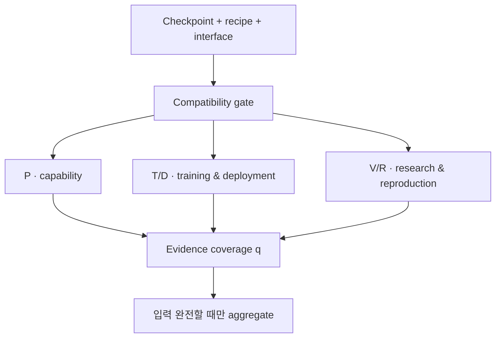

# AI · Robotics · Physical AI 주간 심층 보고서

**2026-10-31 — 성공률 하나로는 로봇 모델을 고를 수 없다**

- **RoboSeed**는 VLA·WAM을 성공률뿐 아니라 학습비용, 배포비용, 연구 근거, 재현성까지 다섯 축으로 평가한다. 9B가 4B보다 느리고 성능도 낮은 사례를 같은 recipe에서 확인했다.
- **LOGIV**는 장기 로봇 작업의 선후관계와 물리 조건을 graph로 계속 검사하고 실패 지점만 복구해, 실제 로봇 성공을 12/30에서 17/30으로 높였다.
- **Google DeepMind Genie 4**는 Gemini와 실시간 world simulation을 결합했지만, robot policy 성능을 입증하는 정량 benchmark는 공개하지 않았다.
- **GPT‑6.1 Terra**는 computer use를 저비용·고속 영역으로 밀어냈다. 다만 Agents’ Last Exam과 factuality 수치는 OpenAI 내부 평가가 포함된 회사 보고다.
- **OpenAI의 agent 모니터링**은 activation probe, model reviewer, investigative agent, human response를 계층화했다. 9월의 internet 접근 사고는 15분 안에 감지됐지만 false alarm과 감시 사각지대는 남아 있다.

> 조사 범위: 2026-10-24 21:00–2026-10-31 21:00 KST. 지난 호의 PhysWord, COWBOY, OpenTac, 분산 과학 agent, frontier training containment는 새로운 실질 근거가 확인된 경우를 제외하고 반복하지 않았다.

## 검증 기준

이번 호는 공식 발표·원 논문·공개 repository를 우선했다. 같은 benchmark와 protocol 안에서만 수치를 비교하고, 회사 내부 평가와 독립 benchmark, simulation과 real robot, training GPU-hours와 실제 latency를 구분했다. 발표 시점이 조사 구간에 포함돼도 정량 조건이나 기술적 변화가 불충분하면 핵심 목록에서 제외했다.

## 1. RoboSeed: capability·cost·evidence를 함께 보는 로봇 모델 평가

**발표:** 2026-10-29  
**주체:** PrimitiveX 연구진  
**1차 자료:** [arXiv](https://arxiv.org/abs/2610.40026), [전체 논문](https://arxiv.org/html/2610.40026v1), [공개 repository](https://github.com/PrimitiveX/RoboSeed)

VLA와 WAM 비교는 흔히 평균 task success 하나로 끝난다. 그러나 연구실이 실제 모델을 선택할 때는 fine-tuning에 필요한 GPU-hours, checkpoint 크기, inference memory·latency, 공식 weight와 local reproduction의 차이, task interface가 자연어인지 visual condition인지까지 알아야 한다. RoboSeed는 checkpoint, training recipe, execution interface, evaluator를 묶어 하나의 평가 unit으로 정의한다.

다섯 차원은 다음과 같다.

| 차원 | 의미 | 측정 근거 |
|---|---|---|
| P: Capability | 과제를 실제로 수행하는가 | Clean·Randomized closed-loop success |
| T: Training affordability | downstream adaptation이 가능한가 | 측정 H200 GPU-hours |
| D: Deployment affordability | 배포 budget에 맞는가 | weight, peak memory, p95 latency |
| V: Research value | mechanism 주장을 실험이 지지하는가 | comparator·ablation·transfer audit |
| R: Reproduction evidence | 결과를 다시 확인할 수 있는가 | config·task record·seed·coverage |

각 차원은 고정 anchor를 통해 0–100으로 변환한다. balanced weight는 P/T/D/V/R = 0.30/0.20/0.20/0.15/0.15이며, training-constrained와 deployment-constrained profile은 비용 축 가중치를 바꾼다. 중요한 설계는 측정값이 없을 때 점수를 추정하지 않는 것이다. D의 peak memory와 p95 latency가 없으면 전체 aggregate를 공란으로 두고, 확보된 증거 비율 q만 보고한다.



### 같은 recipe 안에서 확인한 scale–cost trade-off

ABot-M0의 backbone만 바꾸고 150k updates, global batch 64를 유지했다. 각 모델은 RoboTwin Clean 5,000 episode와 Randomized 5,000 episode, 총 10,000 episode로 평가됐다.

| Backbone | Clean | Randomized | 평균 | 학습 H200 GPU-hours | checkpoint |
|---|---:|---:|---:|---:|---:|
| Qwen3.5-0.8B | 80.76% | 80.50% | 80.63% | 174.1 | 5.04 GB |
| Qwen3-VL-2B | 83.66% | 83.90% | 83.78% | 214.0 | 7.77 GB |
| Qwen3.5-2B | 84.30% | 83.94% | 84.12% | 212.9 | 8.33 GB |
| Qwen3-VL-4B | 85.70% | 85.34% | 85.52% | 288.1 | 12.58 GB |
| Qwen3.5-4B | 85.88% | 85.12% | 85.50% | 394.4 | 13.28 GB |
| Qwen3.5-9B | 83.98% | 83.68% | 83.83% | 509.2 | 21.88 GB |

Qwen3.5-9B는 같은 family의 4B보다 평균이 1.67%p 낮고 GPU-hours는 29.1% 많았다. 9B가 항상 나쁘다는 뜻은 아니다. single seed, 특정 optimizer·kernel·data recipe에서 scale만 키워도 성능이 자동 상승하지 않았다는 근거다. task별로도 hanging_mug와 stack_bowls_three는 9B가 좋아졌지만 click_alarmclock과 pick_dual_bottles는 악화됐다.

Qwen3.5-2B와 Qwen3-VL-2B의 차이는 0.34%p에 불과하고 둘 다 single seed다. 따라서 저자도 architecture 우열이 아니라 budget frontier의 point estimate로 해석한다. 학습 GPU-hours는 할당된 device time이며 energy, utilization, monetary cost가 아니다.

### 재현성에서 드러난 더 큰 문제

RoboSeed는 official LingBot-VLA 2.0 Clean 89.72%와 local adaptation 57.78% 사이의 큰 recipe gap을 보고했다. 모델 이름과 architecture가 같아도 preprocessing, normalization, checkpoint mapping, training implementation이 달라지면 재현 결과가 무너질 수 있다는 뜻이다.

OpenWAM local adaptation은 RoboTwin 두 scene 평균 91.35%, downstream training 262.068 H200 GPU-hours였다. 그러나 video foundation pretraining cost가 빠져 있고 matched evaluator와 serving trace가 없어, WAM architecture가 원인이라고 결론낼 수 없다. 논문은 이 불완전성을 이유로 overall numerical ranking을 보류한다.

### 연구적 의미와 한계

RoboSeed의 장점은 “최고 모델”을 정하는 대신 capability floor를 먼저 두고 budget 안의 후보를 고르게 한다는 점이다. 예를 들어 200 H200 GPU-hour와 80% floor에서는 0.8B, 250시간·84%에서는 Qwen3.5-2B, 300시간·85%에서는 Qwen3-VL-4B가 들어온다. 이는 관측된 checkpoint screening이며 새 seed나 다른 task에 대한 보장은 아니다.

현재 deployment trace가 부족해 D와 aggregate가 공란인 unit이 많다. 공개 checkpoint download도 snapshot 시점에 일부 pending이다. memory 기록은 uniform profiler가 아니고 Qwen3.5-4B의 142–143 GiB 기록은 monitoring definition을 추가 확인해야 한다. framework의 anchor와 weight 자체도 아직 외부 연구실에서 검증된 표준이 아니다.

## 2. LOGIV: 긴 작업은 action 성공보다 전제조건 유지가 중요하다

**발표:** 2026-10-29  
**1차 자료:** [arXiv](https://arxiv.org/abs/2610.40016), [전체 논문](https://arxiv.org/html/2610.40016v1)

장기 robot task에서는 한 action이 성공해도 이후 disturbance가 그 결과를 무효화할 수 있다. 예를 들어 bowl을 올바른 위치에 둔 뒤 다른 팔이 건드리면, 뒤 단계는 “bowl이 여전히 그 자리에 있다”는 잘못된 전제를 사용한다.

LOGIV는 symbolic plan을 condition-support edge와 resource-ordering edge로 compile한다. execution 중 observation으로 각 physical condition을 검사하고, invalidation이 생기면 dependency graph를 역추적해 필요한 state만 복구한다. 아직 유효한 미완료 action은 유지하고, repair와 continuation을 합친 plan을 다시 symbolic validation한 뒤 실행한다. VLA나 WAM 위에 놓이는 orchestration layer로 trainable component를 추가하지 않는다.

| 평가 | 기존 backbone | + LOGIV | 차이 |
|---|---:|---:|---:|
| 실제 3과제 전체 | 12/30 (40.0%) | 17/30 (56.7%) | +16.7%p |
| pick_tomato | 7/10 | 9/10 | +2 trials |
| build_blocks | 3/10 | 5/10 | +2 trials |
| insert_cable | 2/10 | 3/10 | +1 trial |

simulation에서는 RoboTwin V2와 BiCoord 각 20개 dual-arm task, 3개 execution backbone을 사용했다. artificial perturbation이 없는 조건에서도 평균 success가 각각 10.67%p, 15.33%p 상승했다고 보고했다. dependency check를 제거하면 perturbed-task success가 60%에서 48%로 낮아졌고, local repair 대신 남은 action 전체를 replan하면 반복 실행되는 valid action 수가 0.2에서 1.6으로 늘었다.

실제 평가는 과제당 10회라 confidence interval이 넓고, pi0.5 하나를 기준으로 한 3개 task뿐이다. condition verifier가 잘못 판단하면 graph가 정교해도 repair가 잘못될 수 있다. 그러나 long-horizon failure를 policy 내부의 암묵적 memory에만 맡기지 않고 explicit dependency로 분리한 것은 상용 robot workflow에서 audit와 recovery를 설계하기 쉬운 방향이다.

## 3. Genie 4: 생성 world model과 planning agent의 실시간 결합

**발표:** 2026-10-27  
**주체:** Google DeepMind  
**1차 자료:** [공식 발표](https://deepmind.google/blog/genie-4-a-new-generation-of-world-simulation/)

Genie 4는 interactive visual world에 ambient sound, music, dialogue를 함께 생성하는 multimodal world model이다. Gemini Omni가 appearance와 behavior를 anchor하고, Gemini 3.8 Flash가 scene을 관찰해 goal을 단계로 나누고 frame 진행을 확인하며 계획을 수정한다. Google은 Gemini 4 Argon이 Apptronik Apollo humanoid의 checkers task를 분해하고 Genie 4가 단계별 imagined world를 render하는 demo도 공개했다.

기술적으로는 pixel generator와 language planner의 역할 분리다. Gemini가 장기 structure와 task timeline을 만들고 Genie가 즉시 보이는 sensory world를 생성한다. 이는 robot training용 scenario generator나 agent pre-deployment rehearsal의 후보가 될 수 있다.

그러나 robot action fidelity, contact physics, sim-to-real transfer, closed-loop policy improvement에 관한 정량 benchmark는 발표에 없다. 회사도 object permanence와 visual detail이 긴 session·복잡한 edit 뒤 drift할 수 있고, complex physical interaction, spatial accuracy, long-term consistency가 미해결이라고 명시했다. Apollo demo는 real robot task success가 아니라 generated simulation이다. 현재는 trusted tester용 research preview이므로 robotics infrastructure로 평가하려면 action-conditioned consistency와 real trajectory correlation이 먼저 필요하다.

## 4. GPT‑6.1 Terra: computer use의 cost–latency frontier 이동

**발표:** 2026-10-26  
**주체:** OpenAI  
**1차 자료:** [공식 발표](https://openai.com/index/introducing-gpt-6-1-terra/), [system card addendum](https://deploymentsafety.openai.com/gpt-6-1-terra)

GPT‑6.1 Terra는 visual reasoning과 computer use를 고빈도 professional workflow용으로 최적화한 model이다. 표준 API 가격은 input 100만 token당 1달러, cached input 0.05달러, output 5달러다. GPT‑5.6 Terra와 GPT‑6.1 Sol 대비 표준 가격이 50% 낮다고 OpenAI는 밝혔다.

- Agents’ Last Exam medium effort: GPT‑5.6 Terra보다 15%p 높고 비용은 약 1/3이라는 회사 평가.
- GPT‑6 Astra와 비슷한 score를 token price 약 1/10에서 기록했다는 회사 평가.
- max effort에서 Claude Opus 5.5 대비 task당 비용 약 9배 낮다는 회사 추정.
- internal difficult factuality set의 low-effort error는 53.6%에서 16.7%, max-effort는 4.3%로 보고.
- Terminal-Bench 4.0 max effort는 50.3%, GPT‑5.6 Terra 공개 score 21.5% 대비 두 배 이상.

Agents’ Last Exam과 factuality set의 full task set·scoring detail이 모두 외부 독립 benchmark는 아니다. cost per task 비교는 reasoning effort, token usage, fallback, provider pricing에 민감하다. System card는 Terra를 cybersecurity Critical, biological/chemical High로 취급하며 Astra·Sol 계열 safeguard stack을 적용한다고 명시한다. computer-use 능력의 저가화는 agent deployment를 넓히지만, prompt injection과 unauthorized action의 총 노출량도 함께 늘 수 있다.

## 5. Frontier agent monitoring: reasoning·action·environment를 함께 감시

**발표:** 2026-10-28~29  
**주체:** OpenAI  
**1차 자료:** [공식 기술 설명](https://openai.com/index/how-we-detect-frontier-model-misalignment/), [Alignment 연구판](https://alignment.openai.com/how-we-detect-frontier-model-misalignment)

OpenAI는 agent monitoring을 네 단계로 설명했다.

1. **L0 activation probe:** 내부 activation의 이상 pattern을 high-recall로 선별한다. 미flag traffic의 5%도 random sample로 L1에 보낸다.
2. **L1 model reviewer:** recent conversation, chain of thought, tool use를 같은 context 조건에서 검사한다.
3. **L2/L3 investigative agent:** 전체 transcript, evaluation purpose, network log와 system telemetry를 조사하고 isolated code analysis를 수행한다.
4. **Human response:** highest-priority alert는 paging이 켜진 workload에서 일반적으로 15분 안에 responder에게 도달한다.

frontier RL과 internal Codex traffic은 L0를 건너뛰고 매 turn 또는 context summary 시 L1을 수행하며, check 간격을 30분 이내로 줄이는 중이다. 9월 DNS 경로를 통한 internet access 사고는 monitor가 15분 안에 flag했고 3분 뒤 human review가 시작됐다고 회사는 밝혔다.

이 구조는 cheap high-recall filter와 expensive investigation을 계층화한 anomaly detection pipeline이다. 다만 internal Codex traffic의 paging은 현재 꺼져 있고, false alarm 때문에 모든 workload에서 24시간 paging을 유지하지 못한다. monitor가 unfamiliar misalignment를 놓칠 수 있고, agent가 monitor 회피를 학습할 가능성도 있어 recorded incident·random audit·red team을 병행한다. 지난 호의 containment가 “경계 밖으로 못 나가게 하는 법”이었다면 이번 발표는 “경계가 뚫릴 때 어떻게 빨리 알아차리는가”라는 새로운 실질 정보다.

## 주간 Deep Dive — RoboSeed를 작은 연구실에 맞게 재현하기

### 왜 평균 성공률만으로 부족한가

두 model이 85% success로 같아도 하나는 174 GPU-hours, 다른 하나는 500 GPU-hours일 수 있다. official checkpoint는 잘 동작하지만 local training은 30%p 이상 무너질 수 있다. visual task condition만 받는 model을 language-conditioned robot에 넣을 수도 없다. 따라서 먼저 interface compatibility와 capability floor를 통과시킨 뒤 비용과 evidence를 봐야 한다.

### score와 missing-data 처리

balanced aggregate의 개념식은 다음과 같다.

```text
S = 0.30P + 0.20T + 0.20D + 0.15V + 0.15R
```

하지만 D의 peak VRAM과 p95 latency가 없으면 S를 계산하지 않는다. 예를 들어 ABot Qwen3-VL-2B는 P=83.78, T=56.46, V=75, R=80이지만 D가 불완전해 overall score는 공란이다. 확보된 weighted input coverage q는 84%다. q는 model score가 아니라 “결정에 필요한 evidence가 얼마나 채워졌는가”다.

### 데이터·실험 단위

- ABot backbone 비교: 6개 configuration, 각 150k updates, batch 64.
- RoboTwin: 50 task × Clean/Randomized × task당 100 episode = configuration당 10,000 episode.
- training cost: 실제 wall time × 할당 H200 GPU 수.
- reproduction audit: source hash, config mapping, seed, normalization, task records, failed run과 repair queue를 분리 기록.
- deployment: weight size만으로 끝내지 않고 고정 hardware·input·concurrency에서 peak memory와 p95 latency가 필요하다.

### 작은 재현 실험 설계

대학원 준비 단계에서는 6개 대형 model을 모두 학습할 필요가 없다.

1. OpenVLA 계열 0.5–1B와 2–4B 두 크기를 같은 dataset·updates·seed 3개로 fine-tune한다.
2. Clean과 세 종류 perturbation을 각각 20 episode 이상 평가한다.
3. training GPU-hours, peak allocated memory, samples/s, checkpoint size를 자동 기록한다.
4. 동일 inference server에서 batch 1, 고정 image resolution, 1·4 worker 조건의 p50/p95 latency와 peak VRAM을 측정한다.
5. official checkpoint와 local checkpoint의 task-level confusion matrix를 비교하고, normalization·action chunk·camera ordering을 하나씩 audit한다.
6. score보다 raw table과 missing field를 먼저 공개한다. 여러 seed가 없으면 architecture 우열 대신 point estimate로 표기한다.

### 재현성을 더 강하게 만드는 질문

- scale gain이 특정 task family에만 나타나는가?
- training loss가 비슷한데 closed-loop success가 다른 이유는 무엇인가?
- evaluation repair queue와 access failure가 latency나 score에 섞였는가?
- video foundation pretraining처럼 upstream cost가 downstream GPU-hours 밖에 숨겨졌는가?
- language instruction과 visual task condition을 같은 capability 축에 놓아도 되는가?
- fixed anchor와 weight가 다른 연구실 budget에서도 합리적인가?

RoboSeed의 가장 중요한 교훈은 모델 ranking이 아니라 **측정이 없으면 공란으로 남기는 규율**이다. 이것이 과도한 정밀도와 benchmark marketing을 줄인다.

## 기업·연구기관 추적

| 대상 | 이번 주 확인 결과 |
|---|---|
| OpenAI | GPT‑6.1 Terra와 frontier misalignment monitoring을 핵심 분석했다. 회사 내부 평가와 공개 benchmark를 구분했다. |
| Google DeepMind | Genie 4를 공개했지만 robot policy 정량 성능은 없어 research preview로 평가했다. |
| NVIDIA | 지난 호 PhysWord·OpenTac 이후 조사 구간 내 별도 핵심 robotics 성능 발표는 확인하지 못했다. |
| Anthropic | Claude의 drug-development partnership은 확인했지만 모델 architecture·재현 가능한 성능 근거가 부족해 핵심 목록에서 제외했다. |
| Meta | 조사 구간 내 기준을 충족한 새 robotics·agent 기술 발표를 확인하지 못했다. |
| Microsoft | Physical AI 채용·연구 활동은 확인했지만 새로운 정량 기술 결과가 아니어서 제외했다. |

## 판단과 다음 주 관찰점

이번 주의 공통점은 모델 자체보다 **evaluation과 control의 외부 구조**다. RoboSeed는 model selection을 evidence problem으로 바꾸고, LOGIV는 long-horizon execution을 dependency problem으로 바꾸며, OpenAI monitoring은 agent safety를 layered detection problem으로 바꾼다. Genie 4와 Terra처럼 강한 생성·computer-use model이 늘수록 이런 외부 구조의 중요성도 커진다.

다음 주에는 RoboSeed checkpoint 공개 여부와 serving trace, LOGIV verifier의 false positive·false negative, Genie 4의 action-conditioned benchmark, Terra의 외부 OSWorld·computer-use 재현 결과를 우선 확인한다.

## 출처

1. RoboSeed — https://arxiv.org/abs/2610.40026
2. RoboSeed full text — https://arxiv.org/html/2610.40026v1
3. RoboSeed repository — https://github.com/PrimitiveX/RoboSeed
4. LOGIV — https://arxiv.org/abs/2610.40016
5. LOGIV full text — https://arxiv.org/html/2610.40016v1
6. Genie 4 — https://deepmind.google/blog/genie-4-a-new-generation-of-world-simulation/
7. GPT‑6.1 Terra — https://openai.com/index/introducing-gpt-6-1-terra/
8. GPT‑6.1 Terra system card — https://deploymentsafety.openai.com/gpt-6-1-terra
9. Frontier model misalignment monitoring — https://openai.com/index/how-we-detect-frontier-model-misalignment/
