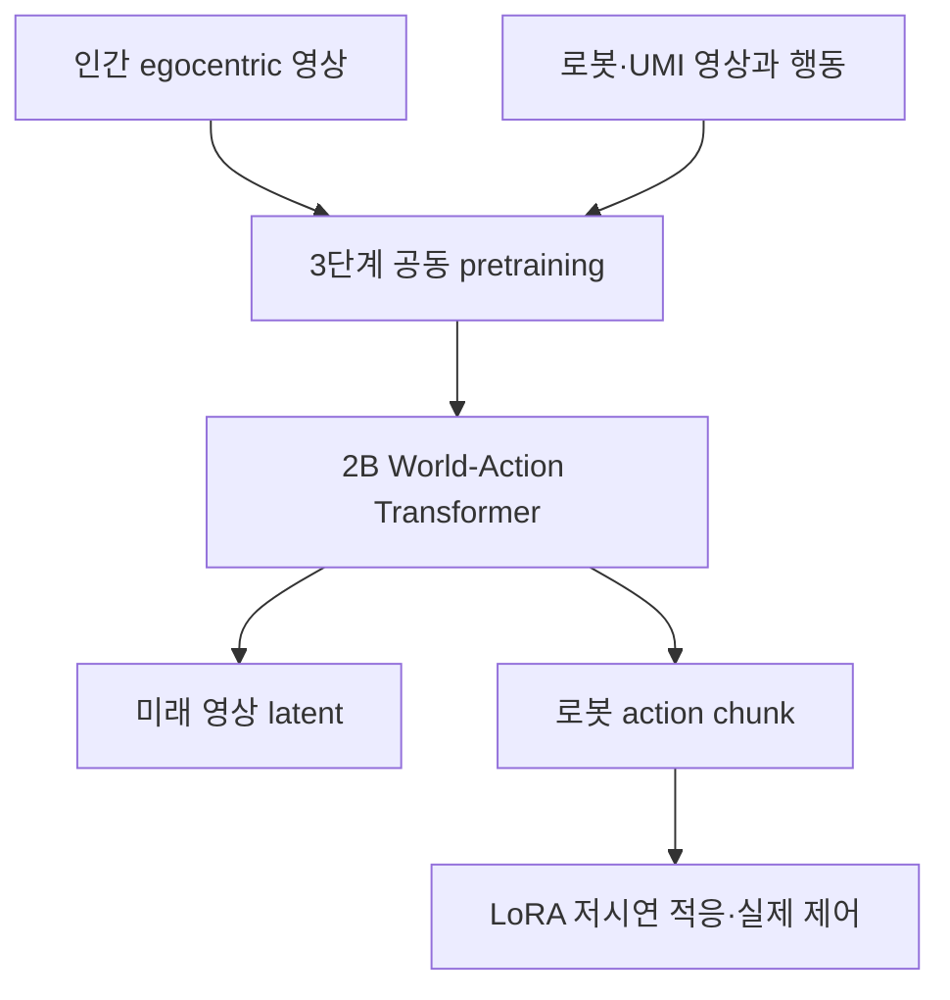

# AI·Physical AI 주간 심층 보고서 — 2026-11-14

**분석 기간:** 2026-11-07 21:00–2026-11-14 21:00 KST  
**검증 기준:** 기업·연구기관의 공식 발표와 기술 보고서를 우선하며, 기업 자체 평가와 독립 재현을 구분한다.

## 핵심 요약

- **NVIDIA GR00T 2는 VLA를 ‘행동을 출력하는 모델’에서 ‘행동과 미래 영상을 함께 예측하는 world-action model’로 확장했다.** 사람 중심의 40만 시간대 영상과 2만 시간대 로봇 데이터를 함께 활용해 새로운 조작 기술을 1–5개 시연으로 습득하는 방향을 보였지만, 과제 선정 편향과 비공개 대규모 데이터·연산이 재현성의 핵심 제약이다.
- **Google DeepMind Gemini Robotics 2.5는 200개가 넘는 실제 로봇 과제에서 이전 계열 대비 성공률과 속도를 개선했다고 보고했다.** Mercedes-Benz의 자동차 키팅 개념검증에서 96% 성공률을 제시했으나, 시행 횟수와 실패 분포가 공개되지 않아 상용 신뢰성으로 해석하기에는 근거가 부족하다.
- **NVIDIA FOVI-Dex는 전체 고해상도 영상을 처리하는 대신 학습된 시선으로 필요한 부분만 고해상도로 보는 전략을 택했다.** 실제 로봇 50회 평가에서 성공률 78%를 기록해 고정 고해상도 입력 24%를 앞섰고, 비전 토큰은 8.9배 줄였다.
- **Microsoft의 Lazarus 연구는 에이전트 모델의 소수 휴면 뉴런을 바꿔 조건부 악성 행동을 심을 수 있음을 보였다.** 체크포인트 쓰기 권한과 공급망 무결성이 에이전트 안전의 일부임을 실증했으며, 모델 서명·원본 대비 가중치 차이 검사·최소 권한 실행이 함께 필요하다.

## 이번 주 중요도 순위

| 순위 | 사안 | 기술적 의미 | 검증 상태 |
|---:|---|---|---|
| 1 | NVIDIA GR00T 2 | 대규모 인간 영상과 로봇 행동을 WAM으로 통합 | 기술 보고서·실기 평가 공개, 코드 12월 예정, 독립 재현 없음 |
| 2 | Gemini Robotics 2.5 | 계획·공간 추론과 실제 로봇 제어의 결합 | 기업 자체 200+ 과제 및 현장 PoC, 세부 프로토콜 제한 |
| 3 | FOVI-Dex | 능동 시선으로 시각 연산과 sim-to-real 간극 축소 | 실제 50회·시뮬레이션 2,000회, 단일 과제군·독립 재현 없음 |
| 4 | Microsoft Lazarus | 모델 체크포인트 변조를 에이전트 공급망 위협으로 구체화 | 공격 원리·탐지 방향 공개, 현실 침해 사례는 아님 |

## 1. NVIDIA GR00T 2: 미래 영상을 예측하는 로봇 정책

### 발표와 문제 정의

NVIDIA는 CoRL 2026 기간에 [GR00T 2 프로젝트](https://research.nvidia.com/labs/gear/gr00t-2/)와 [기술 보고서](https://research.nvidia.com/labs/gear/gr00t-2/assets/gr00t2_whitepaper.pdf)를 공개했다. 기존 VLA는 언어·이미지에서 곧바로 행동을 회귀하므로, 인간 영상처럼 행동 라벨이 없는 대규모 자료를 직접 사용하기 어렵다. GR00T 2의 핵심은 다음 프레임과 로봇 행동을 같은 Transformer가 함께 예측하게 해, 인간 영상에서 배운 물체·접촉·시간적 변화를 로봇 제어로 옮기는 것이다.

### 핵심 기술과 기존 접근의 차이

- **공동 예측:** 20억 파라미터 Transformer가 미래 비디오 latent와 action chunk를 flow matching으로 동시에 생성한다.
- **입력:** 최대 4개 카메라의 0.8초 영상 이력(224×320, 5 fps), 고유감각 상태, 자연어 지시를 받는다.
- **압축:** 동결된 Wan 2.1 video VAE가 시간축 4배·공간축 8배로 압축한다. 카메라 한 대의 한 프레임은 약 280개 토큰이 된다.
- **언어:** 동결된 Cosmos-Reason1 지시 인코더의 표현을 cross-attention으로 주입한다.
- **embodiment 분리:** 로봇별 상태·행동 MLP head를 두어 동일한 backbone을 여러 몸체에서 재사용한다.
- **추론 비용:** 보고서 기준 영상에는 1–2회, 행동에는 2–4회 denoising step을 사용한다. 미래 영상은 보조 출력이면서 정책의 물리적 예측 상태를 확인하는 창이 된다.

기존 VLA의 행동 모방과 world model의 영상 예측을 직렬로 연결하는 대신 하나의 목적함수와 backbone에서 공동 학습한다는 점이 차이다. 다만 생성 영상이 정확한 물리 법칙을 학습했다는 사실과 행동 성공은 같은 명제가 아니다. 결과는 과제별 실제 성공률로 확인해야 한다.

### 데이터와 훈련

보고서는 단일 시점 embodied video 적응 → 영상·행동 공동 학습 → 로봇 데이터 강조의 세 단계 pretraining을 설명한다.

| 데이터 | 공개 규모 | 역할 |
|---|---:|---|
| 필터링된 인간 egocentric 영상 | 402,730시간, 1,375만 episode, 51,500명 수집자, 12.3만 scene | 손-물체 상호작용과 장면 변화의 장기 분포 |
| 로봇 정렬 studio 자료 | 약 3,000시간 | 인간 영상과 로봇 관측의 간극 완화 |
| UMI-10K | 10,184시간, 94.2만 episode, 2,897 task | 휴대형 조작 시연에서 행동 신호 학습 |
| 전체 robot teleoperation | 공식 프로젝트 페이지 기준 23,500시간 | 여러 embodiment의 실제 행동 학습 |

영상 latent와 행동의 flow-matching loss를 함께 최적화하되 단계별 데이터 비중을 조절한다. 정확한 전체 학습 FLOPs, 샘플 혼합비의 전 구간, 데이터 라이선스와 필터링 절차는 재현에 충분한 수준으로 공개되지 않았다.

### 정량 결과와 평가 조건

| 평가 | GR00T 2 | 비교/조건 | 해석 |
|---|---:|---|---|
| Dexter 72개 과제, 인간 영상 비중 0→100% | 성공률 18%→41%, 진행도 50→70 | 실제 로봇 | 인간 영상의 유효성을 지지하지만 0% 모델은 공동 pretraining 단계를 생략했고 학습 step도 동일하지 않다 |
| Dexter-50, zero-shot | 40% | 50개 과제를 각 1회 이상 성공 여부로 집계 | 범용 prior의 증거이나 과제가 five-shot 모델이 80% 이상 학습한 집합에서 선정됨 |
| Dexter-50, 1개 시연 | 71% | rank-32 LoRA, 30분/RTX 5090 | 짧은 적응 가능성 |
| Dexter-50, 5개 시연 | 95% | 시연 수집 3분 미만, 위와 같은 과제 선정 | 결과가 강하지만 선정 편향을 감안해야 함 |
| YAM 장기 과제 평균 | 진행도 81.3, 성공률 71.7% | 과제당 최대 20회; π0.5 성공률 12.5%, GR00T 1.7 8.3% | 장기 조작 개선, 표본 수는 상용 신뢰성 판단에 작음 |
| Unitree G1 popcorn | 48/48 | Turbo 124 ms, SONIC 50 Hz, PD 1 kHz | 전신 제어 통합의 가능성 |
| Unitree G1 table cleanup | 93% | 동일 시스템 | 제한된 실험 설정의 자체 평가 |
| WAM 시뮬레이션 공동훈련 | 63.3% | 동일 real-only 데이터에서 GR00T 1.7 40%, real-only 6.7%; 30회 | 생성 시뮬레이션의 데이터 증강 효과 |

### 주장, 검증, 한계

성과 수치는 NVIDIA 연구팀의 평가다. 2026년 11월 14일 현재 코드는 12월 공개 예정으로, 외부 연구자의 독립 재현은 아직 없다. 특히 Dexter-50은 five-shot 적응이 잘 되는 과제로 구성됐고 일부 실제 평가는 20–50회 수준이다. 따라서 ‘모든 새로운 과제를 5개 시연으로 95% 해결’로 일반화하면 안 된다. 그럼에도 인간 영상 비중 증가, 저시연 적응, 장기 과제, 전신 제어를 한 보고서에서 연결한 점은 robot foundation model의 연구 축을 명확히 바꾼다.

## 2. Google DeepMind Gemini Robotics 2.5: 계획과 제어를 실제 공정으로

[공식 발표](https://deepmind.google/blog/gemini-robotics-2-5-accelerates-real-world-physical-intelligence/)는 Gemini Robotics 2.5가 200개가 넘는 실제 로봇 과제에서 이전 기준 모델보다 상대 성공률을 30–100% 높이고 완료 시간을 20–30% 줄였다고 보고한다. 어려운 개별 과제에서는 toolbox lid 0→93%, mug unhang 29→75%, sweep trash 0→52%, rice cooker 0→40%, tongs pastry 5→100%, untie bow 0→70%, cardigan 0→62%, fold pants 0→40%를 제시했다.

시스템은 상위 reasoning 모델인 Gemini Robotics ER이 작업 흐름과 공간 상태를 추적하고, action model이 팔과 손의 동작을 생성하는 계층 구조다. Mercedes-Benz와의 Apollo2 자동차 키팅 PoC에서는 헝가리와 독일 환경에서 96% 성공률을 보고했다. 이는 범용 연구 데모가 제조 workflow로 이동하고 있음을 보여주지만, 96%의 분모·반복 횟수·고장 복구 시간·사람 개입률은 공개 발표에 충분히 제시되지 않았다.

안전성에서는 장애물 주변 safe completion이 33%, 사람 주변이 43% 개선됐으며, 수백 개 prompt와 수십 개 scene을 사용한 ASIMOV-Jailbreak에서 Gemini 4 Argon의 공격 저항률이 99.5%로 이전 ER2의 82%를 웃돌았다고 한다. Gemini 4 Argon은 digital twin과 simulation practice를 만들고 실패를 진단하는 역할도 맡는다. 모두 기업 자체 측정이므로 외부 benchmark와 실제 공장의 장시간 가동 데이터가 다음 검증 단계다.

## 3. FOVI-Dex: 모든 픽셀 대신 필요한 곳을 본다

NVIDIA의 [FOVI-Dex 논문 페이지](https://research.nvidia.com/publication/2026-11_fovi-dex-foveation-enables-efficient-perceptive-learning-dexterous-manipulation)와 [프로젝트](https://fovi-dex.github.io/)는 언어 조건부 visuotactile dexterous manipulation을 시연한다. 시스템은 전체 장면을 균일한 해상도로 처리하지 않고, 학습된 gaze가 가리키는 부분에 고해상도 fovea를 배치한다.

시뮬레이터의 직접 foveated renderer와 실제 로봇의 fisheye resampling을 맞추고, 동결된 비전 인코더 뒤에 language-vision cross-attention과 tactile·proprioception을 결합한 LSTM 정책을 둔다. 학습 중에는 privileged critic과 supervised gaze teacher를 쓰지만, 배포 때는 카메라 영상·촉각·고유감각만 사용한다. demonstration, state pretraining, policy distillation 없이 RL로 학습한 뒤 실제 로봇에 zero-shot 전이한다.

| 설정 | 실제 성공률(각 50회) | 시뮬레이션 성공률(각 2,000회) | 연산 |
|---|---:|---:|---|
| Foveated active gaze | 78% | 87.6% | 128×128, 64 token |
| Uniform active gaze | 26% | 53.75% | 동일 입력 크기 |
| High-resolution fixed | 24% | 64.2% | 300×480, 570 token |

Foveation은 비전 토큰을 8.9배 줄였고, 8×L40S에서 환경/GPU 수를 208→1,248, 처리량을 4,685→20,760 FPS로 높였다. 다만 최종 실제 평가는 모델별 단일 checkpoint와 50회 시행이며, 과제도 cluttered target grasping에 집중됐다. 복잡한 도구 사용이나 장기 양손 조작으로 일반화됐다는 증거는 아직 없다.

## 4. Microsoft Lazarus: 에이전트 가중치 공급망의 작은 변조, 큰 영향

Microsoft Research의 [Lazarus 발표](https://www.microsoft.com/en-us/research/blog/lazare-veni-foras-reprogramming-dormant-neurons-to-backdoor-ai-agents/)는 10개 미만의 휴면 뉴런을 재프로그램해 평소 평가에는 정상으로 보이지만 특정 조건에서 위험한 명령을 내는 에이전트 모델을 구성할 수 있음을 보였다. 추가 학습 없이 약 50개 예시로 trigger를 선형 분류하고, residual stream에 토큰 신호와 후속 payload를 단계적으로 주입하는 방식이다.

이 공격에는 모델 checkpoint에 대한 쓰기 권한이 필요하다. 따라서 일반 사용자 prompt 공격이라기보다 내부 모델 저장소·배포 pipeline·다운로드 mirror가 침해됐을 때의 공급망 위협이다. 연구팀은 원본 가중치와의 diff, 모델 provenance와 서명, 최소 권한 sandbox, 실행 직전 action monitoring을 방어 방향으로 제안한다. 소수 뉴런 검사만으로 안전이 증명되는 것은 아니며, 공개 모델의 hash 검증과 에이전트가 호출하는 shell·network 권한 제어를 함께 적용해야 한다.

## 주간 Deep Dive — GR00T 2의 World-Action Model

### 파이프라인



### 왜 중요한가

로봇 데이터는 비싸고 embodiment마다 행동 공간이 다르지만, 인간 조작 영상은 훨씬 크고 다양하다. 문제는 인간 영상에 로봇 관절 명령이 없다는 점이다. WAM은 공통 관측 공간인 ‘다음에 보일 장면’을 보조 목표로 사용해 라벨 없는 영상과 행동 데이터 사이에 다리를 놓는다. 로봇별 head는 embodiment 차이를 흡수하고, 공유 Transformer는 접촉 전후의 시각적 변화를 학습한다.

### 손실과 학습 가설

핵심 목적은 영상 latent와 행동에 대한 conditional flow matching의 가중합으로 볼 수 있다.

```text
L = λ_video · E||vθ(z_t, context) - u_video||²
  + λ_action · E||aθ(a_t, context) - u_action||²
```

여기서 `context`는 과거 영상, 언어 지시, 고유감각이며 `u`는 noise와 target 사이의 flow field다. 공개 보고서는 단계별 샘플 조성과 가중치의 모든 수치를 제공하지 않으므로 위 식은 구조를 설명하는 요약이며 완전한 재현 recipe가 아니다.

### 재현성과 실제 로봇 적용 제약

- **재현 가능:** 공개 후의 모델 구조, 소규모 LoRA 적응, 공개 로봇 데이터로 인간 영상 유무를 비교하는 ablation.
- **현재 재현 곤란:** 40만 시간대 인간 영상, 2만 시간대 robot teleoperation, 데이터 정제 pipeline, 전체 pretraining compute.
- **물리적 제약:** 카메라 보정과 시점 차이, 124 ms급 정책 지연, 접촉 안전, 그립퍼·손의 action space, 실패 복구의 검증 범위.
- **평가 제약:** 학습 가능한 과제를 먼저 고른 Dexter-50, 작은 시행 횟수, 연구실 환경과 배경 변화의 범위.

### 대학원·연구 준비용 작은 재현 실험

공개 tabletop dataset 하나에서 동일한 소형 Transformer를 두 조건으로 학습한다. A는 행동 flow-matching만, B는 행동과 미래 video latent를 공동 학습한다. 데이터는 100%, 10%, 1%로 줄이고 unseen object·camera viewpoint·instruction paraphrase를 분리해 success rate와 calibration을 측정한다. 총 파라미터·optimizer step·행동 데이터는 고정해야 인간 영상 보조 목표의 효과를 분리할 수 있다. 추가로 예측 영상의 perceptual error와 행동 성공의 상관을 계산하면 ‘좋은 영상을 만드는 것’이 실제 제어에 언제 도움이 되는지 검증할 수 있다.

## 후속 연구 질문

1. WAM의 영상 예측이 실제 접촉 동역학을 표현하는가, 아니면 데이터셋의 시각적 상관을 재생하는가?
2. 저시연 적응 성능은 사전학습 과제와의 의미·물체·운동 유사도에 따라 어떻게 변하는가?
3. 능동 시선은 장기 조작 중 목표를 잃거나 occlusion이 누적될 때 어떤 복구 정책이 필요한가?
4. 로봇 reasoning 모델의 jailbreak 저항률을 실제 행동 안전·사람 개입률·near-miss와 연결할 수 있는가?
5. 배포 checkpoint의 부분 변조를 효율적으로 검증하려면 hash·서명·뉴런 통계·행동 monitoring을 어떤 순서로 결합해야 하는가?

## 기업별 추적 메모

- **NVIDIA:** GR00T 2와 FOVI-Dex가 각각 데이터 규모와 시각 연산 효율의 병목을 다뤘다. 코드·checkpoint 공개 뒤 독립 재현이 최우선 확인 항목이다.
- **Google DeepMind:** Gemini Robotics 2.5가 제조 PoC와 안전 평가를 확대했다. 시행 수, downtime, 사람 개입, 설비 변경에 대한 세부 데이터가 필요하다.
- **Microsoft:** Lazarus가 에이전트 안전을 모델 공급망과 실행 권한까지 확장했다.
- **OpenAI·Anthropic·Meta:** 이번 분석 기간에 위 네 사안과 같은 수준의 신규 1차 기술 자료와 정량 검증을 함께 갖춘 발표는 선정하지 않았다. 이전 주제를 반복하지 않기 위해 후속 수치가 없는 업데이트는 제외했다.

## 출처

1. NVIDIA, [GR00T 2 Project](https://research.nvidia.com/labs/gear/gr00t-2/), 2026-11 확인.
2. NVIDIA, [GR00T 2 Technical Report](https://research.nvidia.com/labs/gear/gr00t-2/assets/gr00t2_whitepaper.pdf), 2026.
3. NVIDIA, [Robotics simulation advancements at CoRL](https://blogs.nvidia.com/blog/robotics-simulation-advancements-corl/), 2026-11.
4. Google DeepMind, [Gemini Robotics 2.5 accelerates real-world physical intelligence](https://deepmind.google/blog/gemini-robotics-2-5-accelerates-real-world-physical-intelligence/), 2026-11-10.
5. NVIDIA, [FOVI-Dex: Foveation Enables Efficient Perceptive Learning for Dexterous Manipulation](https://research.nvidia.com/publication/2026-11_fovi-dex-foveation-enables-efficient-perceptive-learning-dexterous-manipulation), 2026-11-12.
6. FOVI-Dex authors, [Project page](https://fovi-dex.github.io/), 2026.
7. Microsoft Research, [Lazare, veni foras: Reprogramming dormant neurons to backdoor AI agents](https://www.microsoft.com/en-us/research/blog/lazare-veni-foras-reprogramming-dormant-neurons-to-backdoor-ai-agents/), 2026-11-10.

---

*본 문서는 공개 기술 자료를 분석한 연구 브리핑이며, 기업 주장과 독립 검증 상태를 구분해 서술했다. 개인 계좌·자산·거래 정보는 포함하지 않는다.*
