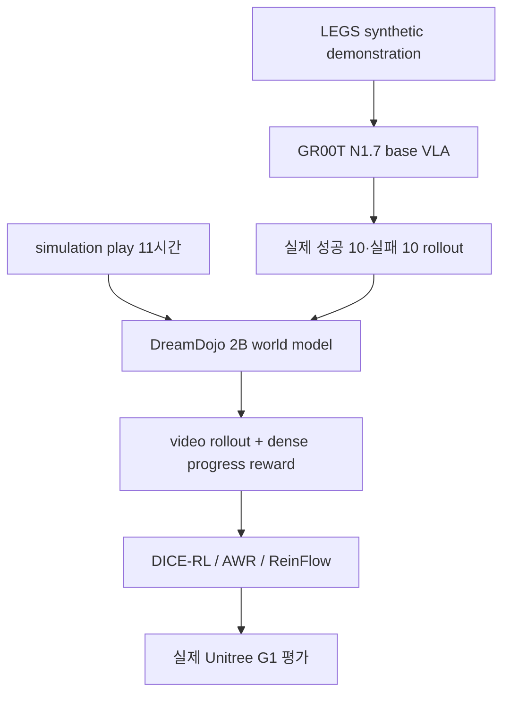

# AI·Physical AI 주간 심층 보고서 — 2026-11-21

**분석 기간:** 2026-11-14 21:00–2026-11-21 21:00 KST  
**검증 기준:** 공식 발표·논문·모델 카드를 우선하며, 기관 자체 평가와 외부 재현을 구분한다.

## 핵심 요약

- **WEVO는 실제 휴머노이드에서 위험한 온라인 탐색을 반복하는 대신, 실제 관측 20개와 비디오 world model을 이용해 VLA를 후학습했다.** 세 과제 평균 성공률이 behavior cloning 23.3%에서 75.0%로 높아졌지만, 과제별 단일 학습 run과 20회 평가이므로 광범위한 일반화 증거는 아니다.
- **Google DeepMind는 Genie 4를 약 1분간 상호작용 가능한 실시간 multimodal world model로 공개했다.** 로봇 학습 환경으로의 잠재력은 크지만 장기 object permanence, 복잡한 물리 상호작용, 공간 정확도는 아직 명시적 한계다.
- **OpenAI 내부 측정에서는 2–4시간 연구 과제의 agent 단독 성공률이 2026년 3월 23%에서 10월 46%로 증가했다.** 작업 종류별 성공률이 25–79%로 크게 갈려, 단일 평균으로 연구 자동화를 판단하기 어렵다는 점이 더 중요하다.
- **Microsoft TokenEconomizer는 모델을 바꾸지 않고 저장소별 경험으로 coding-agent 비용을 18.4–30.9% 줄였다.** 277개 bug-fixing task에서 성공률은 대체로 유지됐지만, 초기 학습 비용과 장기 memory 오염·보안은 추가 검증 대상이다.
- **SHAPE는 2,811시간 인간 egocentric 영상에 이산 EEF 토큰 보조 supervision을 결합했다.** 인간 시연만으로 새 실제 로봇 과제에 전이했을 때 60회 중 21회 성공했으나, joint stream은 0회여서 morphology gap이 여전히 핵심 병목이다.

## 이번 주 중요도 순위

| 순위 | 사안 | 기술적 의미 | 검증 수준 |
|---:|---|---|---|
| 1 | WEVO | 배포 영상에 맞춘 world model 안에서 humanoid VLA RL | 논문·실제 로봇 3과제, 단일 run, 독립 재현 없음 |
| 2 | Genie 4 공개 | 실시간 multimodal 생성 환경을 agent·robot simulation으로 확장 | 모델 카드·제품 preview, 정량표와 로봇 학습 결과 미공개 |
| 3 | OpenAI 연구 가속 측정 | agent가 AI 연구 과정 자체를 얼마나 가속하는지 내부 지표화 | 대규모 내부 로그·설문, 자기보고·과제 선택 변화 주의 |
| 4 | TokenEconomizer | 저장소 경험을 이용한 black-box agent 비용 제어 | 277 SWE-Bench task·6 repo·5 조합, 오픈소스 코드 공개 |
| 5 | SHAPE | 인간 영상의 EEF supervision을 dexterous joint control로 전이 | 실제 9과제·simulation 24과제, 제한된 플랫폼 |

## 1. WEVO: 비디오 World Model 안에서 휴머노이드 VLA를 개선한다

### 문제와 접근

[WEVO 논문](https://arxiv.org/abs/2611.25251)은 2026년 11월 18일 공개됐다. 휴머노이드 VLA를 실제 환경에서 강화학습하면 넘어짐·충돌·장비 손상 위험과 긴 실험 시간이 발생한다. 반대로 simulator RL은 잔여 sim-to-real gap을 보상하는 대신 simulator의 오류를 exploit할 수 있다.

WEVO는 역할을 분리한다. LEGS simulator는 scene reconstruction과 synthetic demonstration으로 초기 정책을 만들고, action-conditioned video world model은 소량의 실제 관측에 맞춰진 정책 개선 환경이 된다.

1. 과제별 synthetic demonstration 200개를 8×L40S에서 30분 이내 생성한다.
2. GR00T N1.7의 vision-language backbone을 고정하고 8×H100에서 50,000 step, 약 3.5시간 fine-tuning한다.
3. 실제 Unitree G1이 성공 10개·실패 10개, 총 20개 retained trajectory를 자율 수집한다.
4. DreamDojo 2B checkpoint를 simulation play data 11시간으로 mid-training한 뒤, 과제별 synthetic 200개와 실제 20개로 adaptation한다.
5. VLA, SONIC–MuJoCo whole-body controller, world model, dense progress reward를 폐루프로 연결해 15 round×32 episode를 생성하고 정책을 업데이트한다.

### 핵심 구조

VLA는 RGB, 15차원 proprioception, 언어 지시에서 40개 target으로 된 18차원 action chunk를 20 Hz로 생성한다. world model은 요청 target이 아니라 WBC가 달성한 43차원 joint state를 조건으로 10 fps의 12개 egocentric frame을 만든다. 이 분리는 관절 동역학은 MuJoCo/WBC가, 물체 접촉과 시각 변화는 video model이 담당하게 한다.

진행도 모델은 frozen DINOv3 feature 위 8-layer, 12-head Transformer이며 16-frame history에서 단계별 progress를 예측한다. 지수평활한 진행도의 차이를 dense reward로 사용한다.

```text
r_t = p̃_t - p̃_(t-1)
p̃_t = 0.7 p̃_(t-1) + 0.3 p_t
```

정책 업데이트는 DICE-RL, ReinFlow, AWR을 비교했다. 가장 좋은 DICE-RL은 frozen flow prior의 후보 action chunk 8개를 20개 critic ensemble로 평가하고 residual correction을 학습한다.

### 정량 평가

| 방법 | Pick & Place | Pick-Turn-Place | Bimanual Basket | 평균 |
|---|---:|---:|---:|---:|
| Behavior cloning | 40% | 20% | 10% | 23.3% |
| Real-robot RL | 60% | 45% | 40% | 48.3% |
| Simulator RL | 30% | 0% | 0% | 10.0% |
| VLAW | 45% | 20% | 35% | 33.3% |
| WMPO | 55% | 30% | 35% | 40.0% |
| WEVO + DICE-RL | **85%** | **75%** | **65%** | **75.0%** |

각 값은 과제별 실제 로봇 20회 평가이며, 방법·과제당 최종 checkpoint 한 개의 단일 학습 run이다. Play-data mid-training을 제거하면 평균 성공률이 75.0%에서 63.3%로, dense reward를 terminal reward로 바꾸면 45.0%로, 온라인 재수집 대신 고정 480 rollout을 사용하면 58.3%로 낮아졌다. 이는 world model 자체보다 **contact-rich play data, dense credit assignment, 현재 정책 분포의 반복 수집**이 함께 필요하다는 증거다.

### 한계와 산업적 의미

과제별 world model·reward model 적응이 필요하고 Unitree G1 interface에 묶여 있다. 실제 데이터 20개도 성공·실패를 10개씩 맞추기 위해 초과 실패를 버렸으므로 자연 발생 분포와 다르다. 한 run·20 trials는 통계적 분산과 rare failure를 평가하기에 작다. 그래도 실제 하드웨어 경험을 대량 생성하지 않고 deployment-aligned video rollouts로 확장하는 구조는 humanoid 후학습의 비용·안전 병목을 직접 겨냥한다.

## 2. Google DeepMind Genie 4: 상호작용 가능한 생성 환경의 공개

[Genie 4](https://deepmind.google/models/genie/)와 [모델 카드](https://deepmind.google/models/model-cards/genie-4/)는 text·image·user action을 받아 실시간 video와 audio를 함께 생성하는 Transformer 계열 world model을 설명한다. Gemini Omni Flash에서 adaptation됐고, Project Genie와 Gemini API·AI Studio의 제한적 preview로 제공된다.

이전 video generator와의 차이는 사용자의 action과 text edit에 즉시 반응하는 폐루프 환경이다. 로봇·embodied agent 연구에서는 고정된 영상 데이터가 아니라 행동에 따라 관측이 바뀌는 훈련 환경으로 쓸 수 있다는 의미가 있다. 다만 공개 문서는 Genie 3 대비 photorealism·movement·steering 개선을 정성적으로 보고할 뿐 benchmark 수치, 물리 일관성 test, 로봇 정책의 sim-to-real 성능은 제공하지 않는다.

현재 연속 상호작용은 약 1분이며, 시간이 길어지거나 edit가 누적되면 visual detail과 object permanence가 drift한다. 복잡한 multi-agent interaction, 실제 장소의 공간 정확도, text rendering, audio accuracy도 제한이다. 따라서 지금 단계에서는 물리 simulator 대체재보다 다양성 높은 시각적 scenario generator 또는 world-model 연구 substrate로 보는 편이 타당하다.

## 3. OpenAI: 연구 가속은 커졌지만 ‘Jagged Frontier’다

OpenAI의 [Research acceleration: The jagged frontier](https://openai.com/index/research-acceleration-jagged-frontier/)는 coding agent가 AI 연구 자체를 얼마나 바꾸는지 내부 로그와 평가로 측정했다.

| 지표 | 측정 결과 | 해석 주의 |
|---|---:|---|
| 2–4시간 추정 과제의 agent 단독 성공 | 3월 23% → 10월 46% | 위임되는 과제 분포가 시기별로 변할 수 있음 |
| 4–8시간 추정 과제 | 13% → 35% | 인간 시간 추정과 내부 harness에 의존 |
| task별 성공률 | training monitoring 79%, training launch 35%, inference/serving code 25% | 평균이 병목을 가림 |
| agent workdays/연구자·일 | 0.5 → 5.7 | 병렬 실행 시간이며 인간 노동시간과 동일하지 않음 |
| peak 동시 agent | 연구자 2/3 이상이 4개 이상, 10% 이상이 16개 이상 | 포함된 연구자 집단 기준 |
| experiment/active experimenter | 2025 baseline의 1.68배 | 인과관계가 agent만으로 식별되지 않음 |

API list price 기준 사용액은 10월 median $2,400/day, 90th percentile $23,000/day였지만 내부 원가나 경제적 생산성을 뜻하지 않는다. 핵심은 agent가 균일하게 사람을 대체한 것이 아니라 monitoring·코드 작성·실험 실행에서 성공률이 크게 갈리고, 사람이 task 선택·검증·재구성에 계속 개입한다는 점이다. 수치는 회사 내부 측정이며 외부 연구실에 그대로 일반화할 수 없다.

## 4. Microsoft TokenEconomizer: 모델을 건드리지 않는 경험 기반 비용 제어

[TokenEconomizer](https://www.microsoft.com/en-us/research/blog/tokeneconomizer-learning-from-experience-to-make-ai-coding-agents-more-efficient/)는 동일 repository에서 반복 작업하는 coding agent가 매번 test command, code structure, 실패 경로를 다시 찾는 낭비를 줄인다. underlying model을 수정하지 않고 session log를 세 방식으로 사용한다.

- **Micro-skills:** 여러 session에서 확인된 repository-specific fact를 한 줄 context로 추가하고 반증되면 폐기한다.
- **Tool pruning:** history상 쓰지 않는 tool description을 제거하되 command·edit core tool은 유지한다.
- **Failure-loop intervention:** judge model이 반복 실패와 진척을 구분해 다른 접근을 제안한다.

Claude Code의 SWE-Bench 60-task profiling에서 repository 내 반복 tool call은 history가 5개 이상 쌓인 뒤 30%였고, repository 간 반복은 7%였다. 제공된 23개 tool 중 16개는 한 번도 호출되지 않았으며 실패한 17% task가 비용의 32%를 차지했다.

본 평가는 6개 repository의 277 SWE-Bench task와 5개 agent-model 조합에서 평균 비용을 18.4–30.9% 줄였고, 모든 30개 repository-combination에서 절감됐다. Pass@1은 네 조합에서 증가했고 전반적으로 안정적이었다. Web-Bench는 16.0–21.2%, 매번 새 repository인 security audit는 6.4–19.6% 절감됐다. 초기 task는 더 비쌀 수 있으나 누적 비용은 모든 repository에서 6번째 task까지 default 아래로 내려갔다.

코드가 공개돼 재현 가능성은 상대적으로 높다. 다만 memory가 잘못된 관행이나 악성 repository 지시를 장기 보존할 위험, judge 비용, benchmark 순서 효과, 실제 대형 조직의 access control은 별도 검증이 필요하다.

## 5. SHAPE: 인간 영상에서 손가락 joint control로 가는 두 개의 action stream

[SHAPE 논문](https://arxiv.org/abs/2611.24585)은 인간과 dexterous robot 사이의 morphology gap을 정면으로 다룬다. 인간 영상에는 robot joint target이 없으므로 공통 표현인 end-effector(EEF) action을 이산 FAST token으로 예측하는 보조 목표를 두고, continuous flow-matching expert는 EEF stream과 joint stream을 병렬로 출력한다.

Pretraining은 인간 egocentric 2,811시간·73,077 episode·320 task와 robot teleoperation 228시간·10,505 episode·105 task를 사용한다. 실제 robot demonstration으로 fine-tuning한 6과제에서 joint-stream score는 robot-only 0.64에서 인간 데이터를 더한 SHAPE 0.80으로 올랐고, 네 binary task 성공은 61/80에서 72/80으로 증가했다.

인간 demonstration만으로 fine-tuning해 task-specific robot demonstration 없이 배포한 3과제에서는 SHAPE EEF stream이 21/60, 35.0%를 기록했다. 인간 데이터 없이 FAST만 쓴 모델은 4/60, FAST 없이 인간 데이터만 쓴 모델은 7/60이었다. 그러나 같은 checkpoint의 joint stream은 0/60이었다. 인간 joint retargeting의 posture가 robot home posture와 달라 joint offset이 잘못 전이되고, EEF readout은 IK가 robot 자세에서 joint를 다시 풀기 때문이다. 이 결과는 인간 데이터가 유용하다는 동시에 direct joint transfer가 아직 해결되지 않았음을 보여준다.

## 주간 Deep Dive — WEVO의 배포 정렬 World-Model RL

### 파이프라인



### 기존 방법과의 차이

Simulator는 geometry와 control constraint를 주지만 appearance·contact gap을 남긴다. 실제 RL은 deployment distribution에 정확하지만 느리고 위험하다. WEVO는 실제 20개 trajectory로 video model의 관측 분포를 맞추고, WBC가 joint dynamics를 계산하게 해 두 표현의 강점을 결합한다. 특히 요청 action이 아니라 달성 joint state로 영상을 조건화해 controller error가 시각 예측에 반영되도록 했다.

### 학습 비용과 재현성

- Base VLA: 과제별 synthetic 200 episode, 8×H100, 3.5시간.
- World-model play mid-training: 500 episode·11시간 데이터, 15,000 step, 8×H100, 10시간.
- Task world model: synthetic 200 + real 20, 30,000 step, 과제별 17시간.
- RL: 480 generated episode, 15,000 update, 과제별 8×H100 약 12시간; 75%는 video generation.

논문은 모델 구성·데이터 수·평가 protocol을 비교적 상세히 공개하지만, 전체 환경 구축과 Unitree G1·GPU 자원이 필요하다. 실제 평가가 method-task별 한 run이라는 점이 가장 큰 재현성 한계다.

### 작은 재현 실험

휴머노이드 대신 tabletop simulator와 공개 robot video dataset으로 축소할 수 있다. 같은 behavior-cloned policy를 기준으로 다음 세 조건을 비교한다.

1. simulator에서 직접 RL,
2. synthetic 영상만으로 학습한 world model에서 RL,
3. 소량의 real/offline 영상으로 adaptation한 world model에서 RL.

동일 rollout budget을 고정하고 success rate, real observation에서의 LPIPS, interaction mask 내부 iPSNR, reward-model calibration을 함께 측정한다. dense progress와 terminal reward, 고정 buffer와 현재 정책 buffer를 각각 ablation하면 WEVO의 핵심 주장을 작은 비용으로 검증할 수 있다.

### 후속 연구 질문

1. 실제 20개 trajectory가 새로운 조명·카메라·물체·바닥 마찰까지 얼마나 포괄하는가?
2. world model이 생성한 접촉 실패를 policy가 exploit하지 않는지 어떤 adversarial test로 확인할 수 있는가?
3. task-specific reward/world model을 공유 multi-task model로 바꿀 때 성능과 compute가 어떻게 변하는가?
4. 여러 독립 seed와 장시간 actual deployment에서 75% 평균이 유지되는가?
5. Genie 4 같은 범용 interactive world model과 robot-specific dynamics model을 어떻게 결합할 수 있는가?

## 기업별 추적 메모

- **OpenAI:** 내부 agent 사용량보다 task별 성공률의 불균일성과 실험 수 증가의 인과관계가 핵심 추적 항목이다.
- **Google DeepMind:** Genie 4는 공개 접근성이 생겼지만 robot training benchmark와 장기 물리 일관성 수치는 아직 없다. Gemini 4 Neon은 11월 18일 모델 카드가 공개됐으나 공급자별 harness가 다른 benchmark는 직접 비교에 주의해야 한다.
- **Microsoft:** TokenEconomizer의 공개 코드로 비용 절감 재현이 가능해졌다. 장기 memory의 보안과 품질 관리가 다음 쟁점이다.
- **NVIDIA:** 이번 주에는 지난주 GR00T 2를 갱신할 독립 재현 결과가 확인되지 않았다. WEVO가 GR00T N1.7과 H100을 사용하지만 NVIDIA 자체 발표로 분류하지 않았다.
- **Anthropic·Meta:** 분석 기간 중 이번 다섯 사안과 같은 수준의 신규 정량 기술 결과는 선정하지 않았다. Meta의 11월 20일 AI for Science 정리는 새 단일 연구 결과보다 기존 프로젝트 묶음에 가까워 제외했다.

## 출처

1. Chen et al., [WEVO: World Model-Enabled VLA Optimization for Whole-Body Loco-Manipulation](https://arxiv.org/abs/2611.25251), 2026-11-18.
2. Google DeepMind, [Genie 4](https://deepmind.google/models/genie/), 2026-11.
3. Google DeepMind, [Genie 4 Model Card](https://deepmind.google/models/model-cards/genie-4/), 2026-11-18.
4. OpenAI, [Research acceleration: The jagged frontier](https://openai.com/index/research-acceleration-jagged-frontier/), 2026-11-18.
5. Microsoft Research, [TokenEconomizer: Learning from Experience to Make AI Coding Agents More Efficient](https://www.microsoft.com/en-us/research/blog/tokeneconomizer-learning-from-experience-to-make-ai-coding-agents-more-efficient/), 2026-11-16.
6. Li et al., [SHAPE: Discrete Supervision and Parallel Continuous Streams for Learning Dexterous Manipulation from Egocentric Human Data](https://arxiv.org/abs/2611.24585), 2026-11-18.
7. Google DeepMind, [Gemini 4 Neon Model Card](https://deepmind.google/models/model-cards/gemini-4-neon/), 2026-11-18.

---

*공개 1차 자료를 바탕으로 작성한 기술 브리핑이다. 성능 수치는 평가 조건과 기관 자체 검증 여부를 함께 읽어야 하며, 개인 계좌·자산·거래 정보는 포함하지 않는다.*
